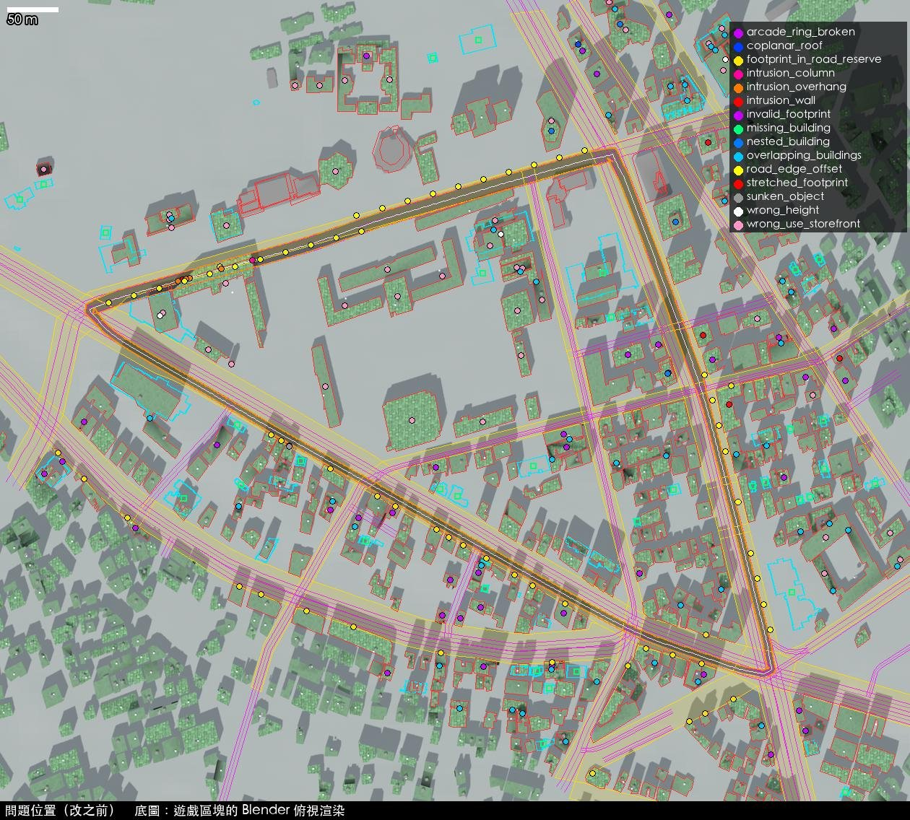
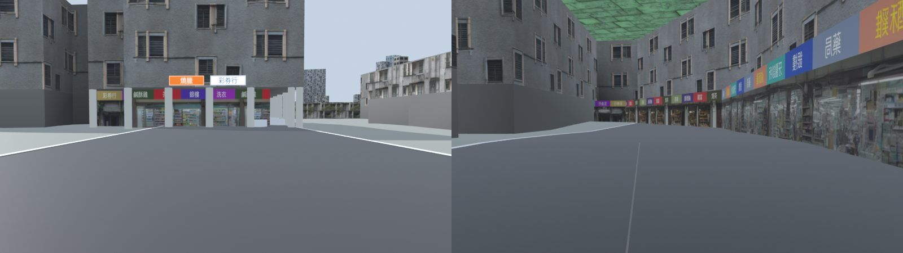
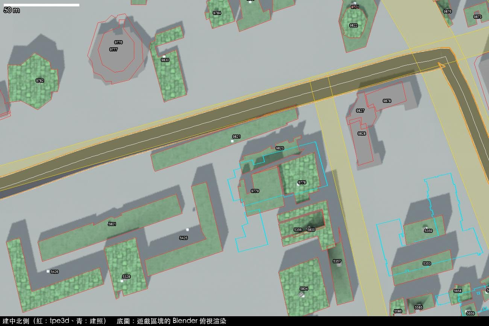

# 建中周邊環線：街景問題清單（現況，2026-10-23）

範圍：建中周邊環線（南海路往西 → 和平西路二、一段 → 重慶南路三、二段，逆時針，1,847 m）中線左右 150 m，加上環線圍住的街廓；
用到的 Blender 區塊是 `t_3_3`、`t_3_4`、`t_4_3`、`t_4_4`（走廊內 416 棟建物）。
座標是遊戲資料座標（TWD97 TM2 減 E 299000、N 2766400，公尺）；遊戲世界座標 = (x − 2800, 2100 − y)。

## 怎麼查的

所有檢查都不開瀏覽器：

1. **賽道幾何**：`tools/test/node/world.js` 在 Node 裡直接跑真正的 `game.js`（假的 DOM、不畫圖），建出和遊戲一模一樣的中線與車道寬。
   結果和 iOS 模擬器實測完全相同：1,847 m、924 條射線、路線摘要一字不差。
2. **射線檢查**：`tools/test/blender_walls.py` 在 Blender 裡載入區塊，用和 `js/walls.js` 相同的規則射線（離路面 1 m、射到路緣）。
   **重現了 iOS 回報的 19／924**。另外加了兩項瀏覽器版沒有的：4 m／8 m 高的射線（樓上懸在車道上）與騎樓柱（遊戲用 instancing 畫，瀏覽器版射不到）。
3. **建物輪廓**：`tools/blender/build_tile.py` 加了 `TGP_DUMP` 選項，把每棟建物「最後真的拿去建模」的輪廓、高度、立面、有沒有騎樓輸出成 JSON，
   再和官方圖層比對（`tools/jianzhong/audit.py`）。
4. **俯視套疊**：Blender 正交俯視渲染區塊，疊在國土測繪中心正射影像上（`tools/jianzhong/blender_views.py top`、`overlay.py`）。
5. **街景**：沿中線每 25 m、前後兩個方向各一張，共 144 張（`blender_views.py street`，駕駛視角 1.3 m、視角 68°）。只有 Blender 區塊，沒有遊戲即時產生的路面標線、護欄。
6. **人工判讀**：隨機抽 50 棟對正射影像逐棟看（`eval/labels.csv`）。

參考圖層與授權見 `ref/SOURCES.md`。正射影像是國土測繪中心 PHOTO2（2024），**不是開放授權**，這裡只做比對顯示。

## 總表

| 類型 | 處數 | 說明 |
|---|---|---|
| 建物在車道裡（1 m 射線） | 2 段（19 條射線） | 南海路西段 376–452 m，`buildings_storefront_ai_*` |
| 樓上懸在車道上（4／8 m 射線） | 7 段（23 條射線） | 同一處；瀏覽器版檢查抓不到 |
| 騎樓柱站在車道裡 | 1 處（2 條射線） | 南海路 372 m |
| 輪廓被拉過馬路（`clear_roads` 把頂點推到路的另一側） | 6 棟 | 包括南海路西段的 tpe3d:2410（國小用地校舍）、2203 |
| 輪廓伸進官方道路用地 > 1 m | 34 棟 | 以臺北市 8m 以上道路圖資的道路用地為準 |
| 騎樓內縮輪廓破掉（一樓店面牆穿出建物，破圖） | 37 棟 | `offset_ring` 遇到凹形輪廓 |
| 輪廓自我交叉 | 10 棟 | tpe3d 簡化後的尖刺、蝴蝶結形 |
| 兩棟重疊、牆面互相穿插 | 47 對 | |
| 一棟整個包在另一棟裡 | 4 對 | |
| 重疊且屋頂同高（屋頂閃爍） | 1 對 | |
| 官方建照有、場景沒有（或位置差很多） | 35 筆 | 多數是 2014 年後的新建案；其中有施工中的工地 |
| 高度和建照樓層差很多 | 3 棟（另有 2 棟 21F、14F 新大樓整棟缺） | 高度誤差 MAE 7.8 m、平均偏低 4.9 m（17 筆有樓層的建照） |
| 多出來的建物（現地是樹林、空地、工地） | 標註樣本 50 棟中 3 棟（6%） | 推估走廊內約 25 棟；另有 tpe3d:9821 整條躺在南海路上 |
| 學校／機關／公園內的建物做成騎樓店面 | 43 棟 | 有店名招牌、機車、騎樓柱 |
| 地標錯誤 | 南海學園宮殿式建築（綠色琉璃瓦）、圓頂建物、建中紅樓 | 全部做成一般公寓 |
| 屋頂材質 | 全部 | 一般建物屋頂全用綠色防水層；標註樣本 42 棟可判讀，0 棟是綠色防水層（23 棟灰色水泥平頂、7 棟鐵皮、8 棟混合） |
| 路緣和官方人行道邊線差 > 2 m | 30 處（每 25 m 取樣） | 南海路 21、重慶南路 9 |
| 浮空 | 0 | 建物底部一律在 DEM 最低點下 1.5 m |
| 下沉 | 25 台機車 | 放在地形高度，但落在遊戲人行道（高 0.17 m）範圍內 |

## 主要問題與成因

### 1. 南海路西段：國小校舍被拉過整條馬路，還做成騎樓商店街

tpe3d:2410（使用分區「國小用地」的 L 形校舍）的輪廓本來就有一角伸進南海路。`build_tile.py` 的 `clear_roads()` 把每個頂點沿「離最近道路中線的方向」推到路寬一半以外；
落在中線另一側的頂點被推到馬路**對面**，整棟建物被拉成橫跨南海路的長條（下圖綠色屋頂那一塊）。
接著因為它「臨街」又「不高」，被做成騎樓店面：從南海路往西開，正前方是一整排「燒臘、彩券行、鹹酥雞、銀樓」的店面牆，車子要穿過店裡。
這就是 iOS 版回報的 19／924。

### 2. 南海路的行駛中線偏南約 6 m

官方人行道圖層量到：南海路西段的實際路面寬約 16 m（南側路緣離遊戲中線 1.5–2 m、北側 14.5 m）。
遊戲的中線來自 OSM，車道半寬 7.15 m，所以南側車道有約 5.5 m 壓在建中、國小的圍牆與校舍上，北側反而留了 4 m 空地。
這是路線資料（`data/taipei_osm.json`）的問題，不在區塊裡；區塊只能讓建物退到遊戲車道外。要不要改路線資料列為待決定事項。
南海路東段（往重慶南路）相反：遊戲車道比實際窄 2–4.5 m。

### 3. tpe3d 資料舊、輪廓粗

- tpe3d:9821 是一條約 80 m 長、躺在南海路南半邊的輪廓，現地是路面與行道樹（下圖）。
- 2014 年以後的新大樓沒有：例如 21 樓（tpe3d:2200 一帶，場景是 24 m 的舊屋）、14 樓（tpe3d:5658 一帶，場景 14 m）。
- 已拆除或施工中的基地還留著舊建物（標註樣本 #14）；樹林、停車場上有建物（#13、#31）。
- 很多輪廓一塊包好幾間透天，或只蓋到屋頂的一部分（標註樣本 50 棟中 `footprint_ok` 只有 20 棟吻合、18 棟部分吻合、11 棟不吻合）。

（左上起：建照 21 樓、建照 14 樓、樹林上的建物、空地上的建物、工地、有尖刺的輪廓）

### 4. 內容不對

- 學校、機關、公園裡的建物（建中、國小、南海學園、郵政用地）一律依高度套公寓立面，臨內部道路的還加騎樓、店名招牌與機車：43 棟。
- 南海學園的宮殿式綠色琉璃瓦屋頂、八角圓頂建物、建中紅樓都只是平頂方盒子。
- 一般建物屋頂全部是綠色防水層貼圖；這一帶實際上以灰色水泥平頂、鐵皮加蓋為主。

### 5. 破圖（z-fighting、穿插）

- 騎樓的一樓店面牆用 `offset_ring()` 把臨街邊往內縮 3 m；凹形輪廓的內縮頂點會跑到建物外或交叉，店面牆就穿出建物（37 棟）。
- tpe3d 的建物零件互相重疊（47 對），牆面互相穿插；1 對屋頂同高會閃爍。

## 逐項清單

### 騎樓內縮輪廓破掉（破圖）（`arcade_ring_broken`，37 處）

| # | 位置（資料座標 x, y） | 建物／路段 | 量測 |
|---|---|---|---|
| 1 | 2393, 2745 | tpe3d:2179 |  |
| 2 | 2525, 2721 | tpe3d:2195 |  |
| 3 | 2277, 2762 | tpe3d:2300 |  |
| 4 | 2354, 2693 | tpe3d:2402 |  |
| 5 | 2372, 2705 | tpe3d:2405 |  |
| 6 | 2444, 2640 | tpe3d:2452 |  |
| 7 | 2788, 2503 | tpe3d:5312 |  |
| 8 | 2637, 2658 | tpe3d:5319 |  |
| 9 | 2698, 2655 | tpe3d:5321 |  |
| 10 | 2741, 2700 | tpe3d:5322 |  |
| 11 | 2665, 2649 | tpe3d:5494 |  |
| 12 | 2756, 2588 | tpe3d:5499 |  |
| 13 | 2747, 2553 | tpe3d:5503 |  |
| 14 | 2785, 2561 | tpe3d:5554 |  |
| 15 | 2783, 2595 | tpe3d:5563 |  |
| 16 | 2765, 2550 | tpe3d:5565 |  |
| 17 | 2971, 2793 | tpe3d:5287 |  |
| 18 | 2870, 2720 | tpe3d:5288 |  |
| 19 | 2868, 2732 | tpe3d:5289 |  |
| 20 | 2867, 2555 | tpe3d:5337 |  |
| 21 | 3100, 2459 | tpe3d:5373 |  |
| 22 | 3146, 2785 | tpe3d:5381 |  |
| 23 | 3107, 2789 | tpe3d:5385 |  |
| 24 | 2856, 2504 | tpe3d:5538 |  |
| 25 | 3073, 2415 | tpe3d:5592 |  |
| 26 | 2943, 2594 | tpe3d:5626 |  |
| 27 | 3107, 2439 | tpe3d:5675 |  |
| 28 | 3006, 2494 | tpe3d:5805 |  |
| 29 | 2961, 2821 | tpe3d:5285 |  |
| 30 | 3015, 2806 | tpe3d:5286 |  |
| 31 | 2931, 2811 | tpe3d:5290 |  |
| 32 | 3080, 2828 | tpe3d:5389 |  |
| 33 | 3135, 2836 | tpe3d:5718 |  |
| 34 | 2886, 3111 | tpe3d:9654 |  |
| 35 | 2900, 3089 | tpe3d:9781 |  |
| 36 | 3065, 3041 | tpe3d:9885 |  |
| 37 | 3048, 3035 | tpe3d:9887 |  |

### 輪廓伸進官方道路用地（`footprint_in_road_reserve`，34 處）

| # | 位置（資料座標 x, y） | 建物／路段 | 量測 |
|---|---|---|---|
| 1 | 2568, 2574 | tpe3d:2189 | area_m2=42.2, depth_m=2.6 |
| 2 | 2547, 2582 | tpe3d:2193 | area_m2=12.8, depth_m=1.1 |
| 3 | 2596, 2721 | tpe3d:2196 | area_m2=10.7, depth_m=2.0 |
| 4 | 2393, 2688 | tpe3d:2197 | area_m2=23.1, depth_m=1.8 |
| 5 | 2368, 2714 | tpe3d:2405 | area_m2=12.5, depth_m=1.5 |
| 6 | 2436, 2650 | tpe3d:2452 | area_m2=35.6, depth_m=2.6 |
| 7 | 2588, 2726 | tpe3d:2474 | area_m2=12.6, depth_m=1.8 |
| 8 | 2578, 2732 | tpe3d:2476 | area_m2=12.3, depth_m=1.5 |
| 9 | 2613, 2558 | tpe3d:5313 | area_m2=43.6, depth_m=2.6 |
| 10 | 2742, 2638 | tpe3d:5317 | area_m2=25.0, depth_m=2.2 |
| 11 | 2636, 2698 | tpe3d:5320 | area_m2=23.3, depth_m=1.9 |
| 12 | 2701, 2661 | tpe3d:5321 | area_m2=11.4, depth_m=1.4 |
| 13 | 2683, 2671 | tpe3d:5323 | area_m2=13.9, depth_m=1.5 |
| 14 | 2660, 2542 | tpe3d:5334 | area_m2=106.2, depth_m=3.0 |
| 15 | 2746, 2516 | tpe3d:5477 | area_m2=12.7, depth_m=1.5 |
| 16 | 2754, 2630 | tpe3d:5493 | area_m2=13.2, depth_m=1.7 |
| 17 | 2768, 2622 | tpe3d:5572 | area_m2=8.6, depth_m=1.4 |
| 18 | 2791, 2610 | tpe3d:5574 | area_m2=25.4, depth_m=2.3 |
| 19 | 2243, 2835 | tpe3d:2183 | area_m2=9.1, depth_m=1.5 |
| 20 | 2528, 2898 | tpe3d:2410 | area_m2=605.1, depth_m=6.8 |
| 21 | 2949, 2520 | tpe3d:5278 | area_m2=48.7, depth_m=1.9 |
| 22 | 2975, 2514 | tpe3d:5279 | area_m2=40.4, depth_m=2.6 |
| 23 | 3008, 2534 | tpe3d:5283 | area_m2=6.1, depth_m=1.0 |
| 24 | 2869, 2564 | tpe3d:5337 | area_m2=22.8, depth_m=1.7 |
| 25 | 2896, 2396 | tpe3d:5524 | area_m2=45.7, depth_m=3.7 |
| 26 | 2856, 2507 | tpe3d:5538 | area_m2=20.9, depth_m=1.3 |
| 27 | 2837, 2583 | tpe3d:5560 | area_m2=5.6, depth_m=1.1 |
| 28 | 2819, 2593 | tpe3d:5564 | area_m2=8.2, depth_m=1.1 |
| 29 | 3008, 2456 | tpe3d:5609 | area_m2=14.8, depth_m=2.1 |
| 30 | 2931, 2503 | tpe3d:5610 | area_m2=14.4, depth_m=1.4 |
| 31 | 3033, 2780 | tpe3d:5704 | area_m2=107.1, depth_m=2.9 |
| 32 | 3004, 2505 | tpe3d:5805 | area_m2=42.7, depth_m=2.1 |
| 33 | 2992, 2448 | tpe3d:5808 | area_m2=6.5, depth_m=2.5 |
| 34 | 3035, 2470 | tpe3d:5810 | area_m2=29.1, depth_m=2.2 |

### 輪廓自我交叉（`invalid_footprint`，10 處）

| # | 位置（資料座標 x, y） | 建物／路段 | 量測 |
|---|---|---|---|
| 1 | 2525, 2721 | tpe3d:2195 |  |
| 2 | 2788, 2503 | tpe3d:5312 |  |
| 3 | 2693, 2496 | tpe3d:5472 |  |
| 4 | 2785, 2561 | tpe3d:5554 |  |
| 5 | 2534, 2939 | tpe3d:4158 |  |
| 6 | 2673, 3106 | tpe3d:9842 |  |
| 7 | 2856, 2504 | tpe3d:5538 |  |
| 8 | 3085, 2690 | tpe3d:5690 |  |
| 9 | 3015, 2806 | tpe3d:5286 |  |
| 10 | 2972, 3148 | tpe3d:9647 |  |

### 學校／機關／公園內做成騎樓店面（`wrong_use_storefront`，43 處）

| # | 位置（資料座標 x, y） | 建物／路段 | 量測 |
|---|---|---|---|
| 1 | 2718, 2746 | tpe3d:5422 | zone=高中用地 |
| 2 | 2788, 2744 | tpe3d:5802 | zone=高中用地 |
| 3 | 2632, 2780 | tpe3d:5803 | zone=高中用地 |
| 4 | 2471, 2853 | tpe3d:2203 | zone=國小用地 |
| 5 | 2516, 2816 | tpe3d:2204 | zone=國小用地 |
| 6 | 2533, 2881 | tpe3d:2410 | zone=國小用地 |
| 7 | 2280, 2872 | tpe3d:2411 | zone=機關用地 |
| 8 | 2539, 2802 | tpe3d:2484 | zone=國小用地 |
| 9 | 2478, 2945 | tpe3d:4155 | zone=公園用地 |
| 10 | 2480, 2937 | tpe3d:4157 | zone=公園用地 |
| 11 | 2534, 2939 | tpe3d:4158 | zone=公園用地 |
| 12 | 2353, 2994 | tpe3d:4351 | zone=公園用地 |
| 13 | 2477, 2950 | tpe3d:4362 | zone=公園用地 |
| 14 | 2704, 2869 | tpe3d:5328 | zone=高中用地 |
| 15 | 2748, 2889 | tpe3d:5425 | zone=高中用地 |
| 16 | 2651, 2859 | tpe3d:5426 | zone=高中用地 |
| 17 | 2693, 2895 | tpe3d:5801 | zone=高中用地 |
| 18 | 2795, 2919 | tpe3d:9779 | zone=高中用地 |
| 19 | 2642, 2993 | tpe3d:9782 | zone=公園用地 |
| 20 | 2651, 3082 | tpe3d:9825 | zone=公園用地 |
| 21 | 2695, 3083 | tpe3d:9826 | zone=公園用地 |
| 22 | 2626, 3078 | tpe3d:9833 | zone=公園用地 |
| 23 | 2602, 3078 | tpe3d:9835 | zone=公園用地 |
| 24 | 3200, 2608 | tpe3d:5297 | zone=機關用地 |
| 25 | 3126, 2594 | tpe3d:5372 | zone=機關用地 |
| 26 | 3190, 2635 | tpe3d:5376 | zone=機關用地 |
| 27 | 3114, 2771 | tpe3d:5687 | zone=機關用地 |
| 28 | 3126, 2630 | tpe3d:5703 | zone=機關用地 |
| 29 | 2826, 2810 | tpe3d:5354 | zone=高中用地 |
| 30 | 2821, 2897 | tpe3d:5356 | zone=高中用地 |
| 31 | 2846, 2865 | tpe3d:5357 | zone=高中用地 |
| 32 | 3059, 2846 | tpe3d:5384 | zone=社福及機關用地 |
| 33 | 2827, 2896 | tpe3d:5800 | zone=高中用地 |
| 34 | 2822, 2855 | tpe3d:5804 | zone=高中用地 |
| 35 | 3025, 3092 | tpe3d:9643 | zone=機關用地 |
| 36 | 2913, 3160 | tpe3d:9645 | zone=機關用地 |
| 37 | 3011, 3119 | tpe3d:9649 | zone=機關用地 |
| 38 | 2923, 3138 | tpe3d:9653 | zone=機關用地 |
| 39 | 2856, 3042 | tpe3d:9771 | zone=機關用地 |
| 40 | 2929, 3132 | tpe3d:9774 | zone=機關用地 |
| 41 | 3041, 3094 | tpe3d:9792 | zone=機關用地 |
| 42 | 3024, 3134 | tpe3d:9805 | zone=機關用地 |
| 43 | 2799, 2944 | tpe3d:9823 | zone=高中用地 |

### 輪廓被拉過馬路（`stretched_footprint`，6 處）

| # | 位置（資料座標 x, y） | 建物／路段 | 量測 |
|---|---|---|---|
| 1 | 2471, 2853 | tpe3d:2203 | moved_m=6.8, area_ratio=0.85 |
| 2 | 2533, 2881 | tpe3d:2410 | moved_m=7.3, area_ratio=1.19 |
| 3 | 3031, 2762 | tpe3d:5704 | moved_m=4.1, area_ratio=1.02 |
| 4 | 3005, 2830 | tpe3d:5382 | moved_m=4.1, area_ratio=0.87 |
| 5 | 3140, 2807 | tpe3d:5728 | moved_m=4.2, area_ratio=0.69 |
| 6 | 3010, 3021 | tpe3d:9860 | moved_m=4.2, area_ratio=0.83 |

### 兩棟重疊、牆面穿插（`overlapping_buildings`，47 處）

| # | 位置（資料座標 x, y） | 建物／路段 | 量測 |
|---|---|---|---|
| 1 | 2306, 2726 | tpe3d:2177 ＋ tpe3d:2404 | area_m2=1.7, dz=3.66 |
| 2 | 2458, 2748 | tpe3d:2199 ＋ tpe3d:2409 | area_m2=1.5, dz=34.42 |
| 3 | 2546, 2661 | tpe3d:2469 ＋ tpe3d:2483 | area_m2=7.5, dz=0.79 |
| 4 | 2639, 2666 | tpe3d:5319 ＋ tpe3d:5505 | area_m2=9.1, dz=2.78 |
| 5 | 2745, 2503 | tpe3d:5476 ＋ tpe3d:5477 | area_m2=9.5, dz=3.02 |
| 6 | 2661, 2641 | tpe3d:5494 ＋ tpe3d:5498 | area_m2=2.8, dz=11.3 |
| 7 | 2765, 2461 | tpe3d:5532 ＋ tpe3d:5544 | area_m2=25.4, dz=0.72 |
| 8 | 2786, 2603 | tpe3d:5563 ＋ tpe3d:5574 | area_m2=7.5, dz=7.15 |
| 9 | 2479, 2946 | tpe3d:4155 ＋ tpe3d:4362 | area_m2=35.5, dz=1.81 |
| 10 | 3134, 2578 | tpe3d:5275 ＋ tpe3d:5372 | area_m2=1.4, dz=2.35 |
| 11 | 3197, 2602 | tpe3d:5275 ＋ tpe3d:5297 | area_m2=71.6, dz=19.88 |
| 12 | 3149, 2638 | tpe3d:5275 ＋ tpe3d:5703 | area_m2=12.8, dz=8.62 |
| 13 | 3024, 2579 | tpe3d:5277 ＋ tpe3d:5614 | area_m2=2.8, dz=14.62 |
| 14 | 2957, 2506 | tpe3d:5278 ＋ tpe3d:5339 | area_m2=2.6, dz=1.77 |
| 15 | 2856, 2707 | tpe3d:5288 ＋ tpe3d:5350 | area_m2=4.5, dz=3.75 |
| 16 | 2873, 2727 | tpe3d:5288 ＋ tpe3d:5289 | area_m2=16.3, dz=0.55 |
| 17 | 3232, 2481 | tpe3d:5293 ＋ tpe3d:5414 | area_m2=17.3, dz=3.5 |
| 18 | 2901, 2487 | tpe3d:5338 ＋ tpe3d:5529 | area_m2=4.6, dz=10.24 |
| 19 | 3102, 2636 | tpe3d:5378 ＋ tpe3d:5679 | area_m2=3.7, dz=0.32 |
| 20 | 2827, 2456 | tpe3d:5534 ＋ tpe3d:5535 | area_m2=19.5, dz=7.75 |
| 21 | 2817, 2459 | tpe3d:5534 ＋ tpe3d:5553 | area_m2=14.7, dz=1.02 |
| 22 | 2855, 2499 | tpe3d:5536 ＋ tpe3d:5538 | area_m2=9.2, dz=0.62 |
| 23 | 2870, 2428 | tpe3d:5539 ＋ tpe3d:5540 | area_m2=7.5, dz=0.23 |
| 24 | 2920, 2704 | tpe3d:5578 ＋ tpe3d:5651 | area_m2=10.8, dz=4.83 |
| 25 | 3064, 2444 | tpe3d:5605 ＋ tpe3d:5810 | area_m2=1.3, dz=4.59 |
| 26 | 2983, 2563 | tpe3d:5617 ＋ tpe3d:5621 | area_m2=1.3, dz=2.78 |
| 27 | 2969, 2711 | tpe3d:5630 ＋ tpe3d:5654 | area_m2=2.7, dz=8.09 |
| 28 | 3038, 2713 | tpe3d:5631 ＋ tpe3d:5639 | area_m2=22.1, dz=10.65 |
| 29 | 3068, 2721 | tpe3d:5634 ＋ tpe3d:5635 | area_m2=9.9, dz=0.61 |
| 30 | 3131, 2644 | tpe3d:5680 ＋ tpe3d:5703 | area_m2=49.2, dz=16.25 |
| 31 | 3000, 2487 | tpe3d:5805 ＋ tpe3d:5811 | area_m2=2.3, dz=1.49 |
| 32 | 2825, 2893 | tpe3d:5356 ＋ tpe3d:5800 | area_m2=26.5, dz=0.67 |
| 33 | 2840, 2883 | tpe3d:5357 ＋ tpe3d:5800 | area_m2=11.2, dz=10.71 |
| 34 | 3083, 2823 | tpe3d:5389 ＋ tpe3d:5391 | area_m2=16.8, dz=11.79 |
| 35 | 3084, 2884 | tpe3d:5392 ＋ tpe3d:5717 | area_m2=9.9, dz=2.42 |
| 36 | 3092, 2873 | tpe3d:5392 ＋ tpe3d:5708 | area_m2=3.4, dz=3.66 |
| 37 | 3018, 3112 | tpe3d:9643 ＋ tpe3d:9791 | area_m2=59.8, dz=2.59 |
| 38 | 2918, 3153 | tpe3d:9645 ＋ tpe3d:9774 | area_m2=16.5, dz=6.77 |
| 39 | 3013, 3116 | tpe3d:9649 ＋ tpe3d:9791 | area_m2=21.4, dz=5.84 |
| 40 | 2912, 3048 | tpe3d:9775 ＋ tpe3d:9876 | area_m2=5.5, dz=13.36 |
| 41 | 2798, 2935 | tpe3d:9778 ＋ tpe3d:9779 | area_m2=11.0, dz=7.71 |
| 42 | 2990, 3062 | tpe3d:9780 ＋ tpe3d:9875 | area_m2=27.2, dz=2.6 |
| 43 | 3027, 3128 | tpe3d:9791 ＋ tpe3d:9805 | area_m2=64.8, dz=0.98 |
| 44 | 3026, 2963 | tpe3d:9867 ＋ tpe3d:9891 | area_m2=10.0, dz=2.0 |
| 45 | 2987, 3078 | tpe3d:9875 ＋ tpe3d:9877 | area_m2=14.7, dz=2.95 |
| 46 | 2973, 3077 | tpe3d:9884 ＋ tpe3d:9890 | area_m2=2.5, dz=3.02 |
| 47 | 3048, 2947 | tpe3d:9886 ＋ tpe3d:9888 | area_m2=4.6, dz=3.0 |

### 整棟包在另一棟裡（`nested_building`，4 處）

| # | 位置（資料座標 x, y） | 建物／路段 | 量測 |
|---|---|---|---|
| 1 | 2970, 2792 | tpe3d:5284 ＋ tpe3d:5287 | area_m2=150.7, dz=3.32 |
| 2 | 2978, 2942 | tpe3d:9644 ＋ tpe3d:9861 | area_m2=140.0, dz=5.93 |
| 3 | 2923, 3138 | tpe3d:9653 ＋ tpe3d:9774 | area_m2=84.5, dz=8.18 |
| 4 | 2855, 3032 | tpe3d:9771 ＋ tpe3d:9822 | area_m2=273.5, dz=3.34 |

### 重疊且屋頂同高（z-fighting）（`coplanar_roof`，1 處）

| # | 位置（資料座標 x, y） | 建物／路段 | 量測 |
|---|---|---|---|
| 1 | 2882, 3118 | tpe3d:9654 ＋ tpe3d:9657 | area_m2=2.7, dz=0.04 |

### 官方建照有、場景沒有（`missing_building`，35 處）

| # | 位置（資料座標 x, y） | 建物／路段 | 量測 |
|---|---|---|---|
| 1 | 2672, 2627 | permit:1766 | permit=102.0005.5F, floors=5, covered=0.0 |
| 2 | 2841, 2498 | permit:1769 | permit=105.0032.7F, floors=7, covered=0.0 |
| 3 | 2544, 2742 | permit:1773 | permit=102.0047.10F, floors=10, covered=0.0 |
| 4 | 2492, 2669 | permit:1774 | permit=108.0092.21F, floors=21, covered=0.15 |
| 5 | 2548, 2682 | permit:1775 | permit=108.0206.6F, floors=6, covered=0.0 |
| 6 | 3124, 2746 | permit:1849 | permit=106.0095.7F, floors=7, covered=0.0 |
| 7 | 3093, 2576 | permit:1850 | permit=104.0265.21F, floors=21, covered=0.0 |
| 8 | 3175, 2683 | permit:1852 | permit=111.0166.7F, floors=7, covered=0.0 |
| 9 | 3120, 2905 | permit:1857 | permit=112.0291.7F, floors=None, covered=0.0 |
| 10 | 2976, 2677 | permit:1860 | permit=100.0078.7F, floors=7, covered=0.0 |
| 11 | 2353, 2980 | permit:1864 | permit=101.0312.1F, floors=1, covered=0.0 |
| 12 | 2783, 3123 | permit:1869 | permit=101.0286.3F, floors=3, covered=0.0 |
| 13 | 2738, 3105 | permit:1870 | permit=101.0286., floors=3, covered=0.0 |
| 14 | 2746, 2678 | permit:1885 | permit=110.0282.11F, floors=11, covered=0.14 |
| 15 | 2763, 2671 | permit:1886 | permit=110.0322.14F, floors=None, covered=0.0 |
| 16 | 2906, 2892 | permit:1889 | permit=112.0097.27F, floors=None, covered=0.16 |
| 17 | 2790, 2580 | permit:6634 | permit=98.0012.6F, floors=None, covered=0.0 |
| 18 | 2848, 2426 | permit:6636 | permit=95.0151.6F, floors=7, covered=0.0 |
| 19 | 2853, 2481 | permit:6638 | permit=94.0558.6F, floors=6, covered=0.0 |
| 20 | 2880, 2497 | permit:6639 | permit=99.0041.11F, floors=11, covered=0.0 |
| 21 | 2607, 2706 | permit:6646 | permit=90.0234.6F, floors=6, covered=0.0 |
| 22 | 3146, 2378 | permit:6704 | permit=94.0187.5F, floors=5, covered=0.11 |
| 23 | 3092, 2737 | permit:6749 | permit=96.0270.7F, floors=7, covered=0.0 |
| 24 | 3055, 2681 | permit:6750 | permit=96.0636.5F, floors=5, covered=0.0 |
| 25 | 3067, 2684 | permit:6751 | permit=94.0261.5F, floors=5, covered=0.0 |
| 26 | 3101, 2668 | permit:6752 | permit=95.0528.6F, floors=6, covered=0.0 |
| 27 | 3125, 2698 | permit:6753 | permit=97.0558.7F, floors=7, covered=0.0 |
| 28 | 3111, 2670 | permit:6754 | permit=98.0097.5F, floors=5, covered=0.01 |
| 29 | 3097, 2895 | permit:6766 | permit=93.0512.7F, floors=7, covered=0.0 |
| 30 | 2941, 2646 | permit:6774 | permit=96.0201.4F, floors=4, covered=0.0 |
| 31 | 2915, 2848 | permit:6775 | permit=98.0197.5F, floors=5, covered=0.0 |
| 32 | 2838, 2701 | permit:6777 | permit=96.0667.14F, floors=14, covered=0.0 |
| 33 | 2788, 2892 | permit:6779 | permit=98.0242.4F, floors=4, covered=0.06 |
| 34 | 2329, 2965 | permit:6780 | permit=93.0415.2F, floors=None, covered=0.0 |
| 35 | 2414, 2932 | permit:6783 | permit=91.0286.1F, floors=1, covered=0.0 |

### 高度錯（`wrong_height`，3 處）

| # | 位置（資料座標 x, y） | 建物／路段 | 量測 |
|---|---|---|---|
| 1 | 2468, 2850 | tpe3d:2203 | permit=107.0088.6F, floors=6, h_scene=14.7, h_est=20.2, err_m=-5.5 |
| 2 | 3028, 3103 | tpe3d:9643 | permit=96.0055.8F, floors=8, h_scene=34.8, h_est=26.6, err_m=8.2 |
| 3 | 2805, 2930 | tpe3d:9778 | permit=98.0176.7F, floors=7, h_scene=16.7, h_est=23.4, err_m=-6.7 |

### 建物在車道裡（1 m 射線）（`intrusion_wall`，2 處）

| # | 位置（資料座標 x, y） | 建物／路段 | 量測 |
|---|---|---|---|
| 1 | 2529, 2896 | 南海路 R [376, 432] m | rays=15, min_m=1.4, halfWidth=7.2 |
| 2 | 2490, 2885 | 南海路 L [436, 448] m | rays=4, min_m=0.7, halfWidth=7.2 |

### 樓上懸在車道上（4／8 m）（`intrusion_overhang`，7 處）

| # | 位置（資料座標 x, y） | 建物／路段 | 量測 |
|---|---|---|---|
| 1 | 2560, 2904 | 南海路 L [372, 372] m | rays=1, min_m=1.8, halfWidth=7.2 |
| 2 | 2529, 2896 | 南海路 R [376, 432] m | rays=15, min_m=1.4, halfWidth=7.2 |
| 3 | 2498, 2887 | 南海路 L [436, 436] m | rays=1, min_m=0.7, halfWidth=7.2 |
| 4 | 2498, 2887 | 南海路 R [436, 436] m | rays=1, min_m=2.7, halfWidth=7.2 |
| 5 | 2494, 2886 | 南海路 L [440, 440] m | rays=1, min_m=2.8, halfWidth=7.2 |
| 6 | 2494, 2886 | 南海路 R [440, 440] m | rays=1, min_m=0.6, halfWidth=7.2 |
| 7 | 2486, 2884 | 南海路 L [444, 452] m | rays=3, min_m=4.9, halfWidth=7.2 |

### 騎樓柱在車道裡（`intrusion_column`，2 處）

| # | 位置（資料座標 x, y） | 建物／路段 | 量測 |
|---|---|---|---|
| 1 | 2560, 2904 | 南海路 L [372, 372] m | rays=1, min_m=1.6, halfWidth=7.2 |
| 2 | 2560, 2904 | 南海路 R [372, 372] m | rays=1, min_m=2.3, halfWidth=7.2 |

### 路緣和官方人行道差 > 2 m（`road_edge_offset`，30 處）

| # | 位置（資料座標 x, y） | 建物／路段 | 量測 |
|---|---|---|---|
| 1 | 2888, 3013 | 南海路 R 26 m | game_m=7.2, official_kerb_m=9.7, err_m=-2.5 |
| 2 | 2863, 3006 | 南海路 R 52 m | game_m=7.2, official_kerb_m=9.5, err_m=-2.4 |
| 3 | 2838, 2999 | 南海路 R 78 m | game_m=7.2, official_kerb_m=9.4, err_m=-2.3 |
| 4 | 2813, 2992 | 南海路 R 104 m | game_m=7.2, official_kerb_m=9.2, err_m=-2.1 |
| 5 | 2788, 2984 | 南海路 R 130 m | game_m=7.2, official_kerb_m=9.4, err_m=-2.2 |
| 6 | 2763, 2977 | 南海路 R 156 m | game_m=7.2, official_kerb_m=9.6, err_m=-2.5 |
| 7 | 2738, 2970 | 南海路 R 182 m | game_m=7.2, official_kerb_m=10.0, err_m=-2.8 |
| 8 | 2713, 2963 | 南海路 R 208 m | game_m=7.2, official_kerb_m=10.3, err_m=-3.2 |
| 9 | 2688, 2956 | 南海路 R 234 m | game_m=7.2, official_kerb_m=10.6, err_m=-3.5 |
| 10 | 2668, 2933 | 南海路 L 260 m | game_m=7.2, official_kerb_m=4.5, err_m=2.6 |
| 11 | 2662, 2949 | 南海路 R 260 m | game_m=7.2, official_kerb_m=11.7, err_m=-4.5 |
| 12 | 2643, 2926 | 南海路 L 286 m | game_m=7.2, official_kerb_m=2.8, err_m=4.4 |
| 13 | 2618, 2919 | 南海路 L 312 m | game_m=7.2, official_kerb_m=1.5, err_m=5.6 |
| 14 | 2593, 2912 | 南海路 L 338 m | game_m=7.2, official_kerb_m=1.3, err_m=5.9 |
| 15 | 2568, 2905 | 南海路 L 364 m | game_m=7.2, official_kerb_m=1.4, err_m=5.7 |
| 16 | 2542, 2898 | 南海路 L 390 m | game_m=7.2, official_kerb_m=1.6, err_m=5.6 |
| 17 | 2518, 2891 | 南海路 L 416 m | game_m=7.2, official_kerb_m=1.7, err_m=5.4 |
| 18 | 2492, 2884 | 南海路 L 442 m | game_m=7.2, official_kerb_m=1.9, err_m=5.3 |
| 19 | 2468, 2876 | 南海路 L 468 m | game_m=7.2, official_kerb_m=2.0, err_m=5.1 |
| 20 | 2442, 2869 | 南海路 L 494 m | game_m=7.2, official_kerb_m=2.3, err_m=4.9 |
| 21 | 2418, 2862 | 南海路 L 520 m | game_m=7.2, official_kerb_m=1.6, err_m=5.6 |
| 22 | 3072, 2539 | 重慶南路三段 R 1351 m | game_m=4.0, official_kerb_m=6.5, err_m=-2.5 |
| 23 | 3065, 2564 | 重慶南路三段 R 1377 m | game_m=4.0, official_kerb_m=6.2, err_m=-2.2 |
| 24 | 3059, 2589 | 重慶南路三段 R 1403 m | game_m=4.0, official_kerb_m=6.1, err_m=-2.1 |
| 25 | 3053, 2614 | 重慶南路三段 R 1429 m | game_m=4.0, official_kerb_m=6.1, err_m=-2.1 |
| 26 | 3040, 2665 | 重慶南路三段 R 1481 m | game_m=4.0, official_kerb_m=6.3, err_m=-2.4 |
| 27 | 3027, 2715 | 重慶南路三段 R 1533 m | game_m=4.0, official_kerb_m=6.6, err_m=-2.7 |
| 28 | 3021, 2741 | 重慶南路三段 R 1559 m | game_m=4.0, official_kerb_m=6.9, err_m=-2.9 |
| 29 | 3014, 2766 | 重慶南路三段 R 1585 m | game_m=4.0, official_kerb_m=7.4, err_m=-3.4 |
| 30 | 3007, 2791 | 重慶南路二段 R 1611 m | game_m=5.5, official_kerb_m=7.6, err_m=-2.1 |

### 機車陷進人行道（`sunken_object`，1 處）

| # | 位置（資料座標 x, y） | 建物／路段 | 量測 |
|---|---|---|---|
| 1 | 2596, 2720 |  | count=25 |
