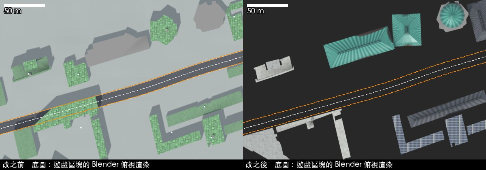
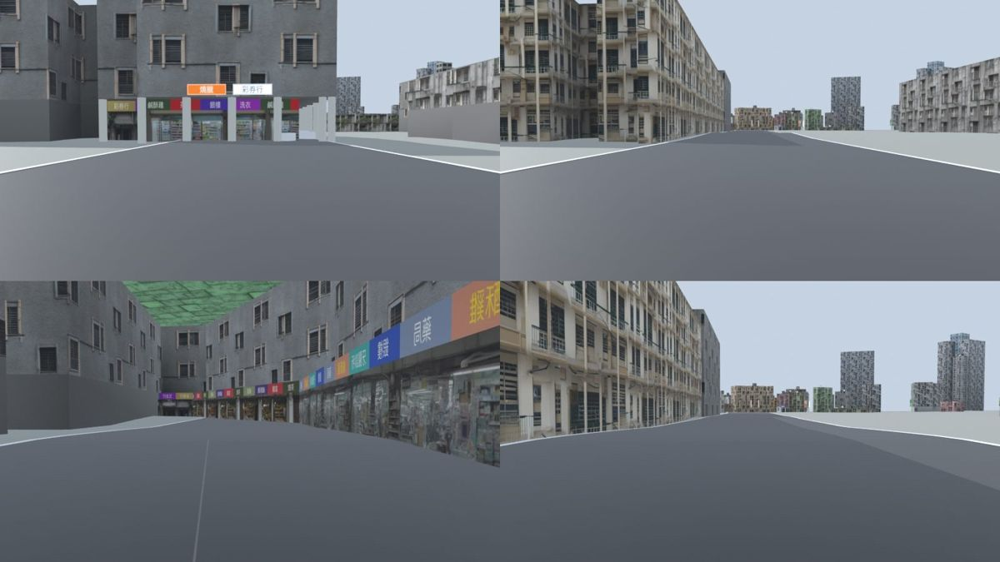
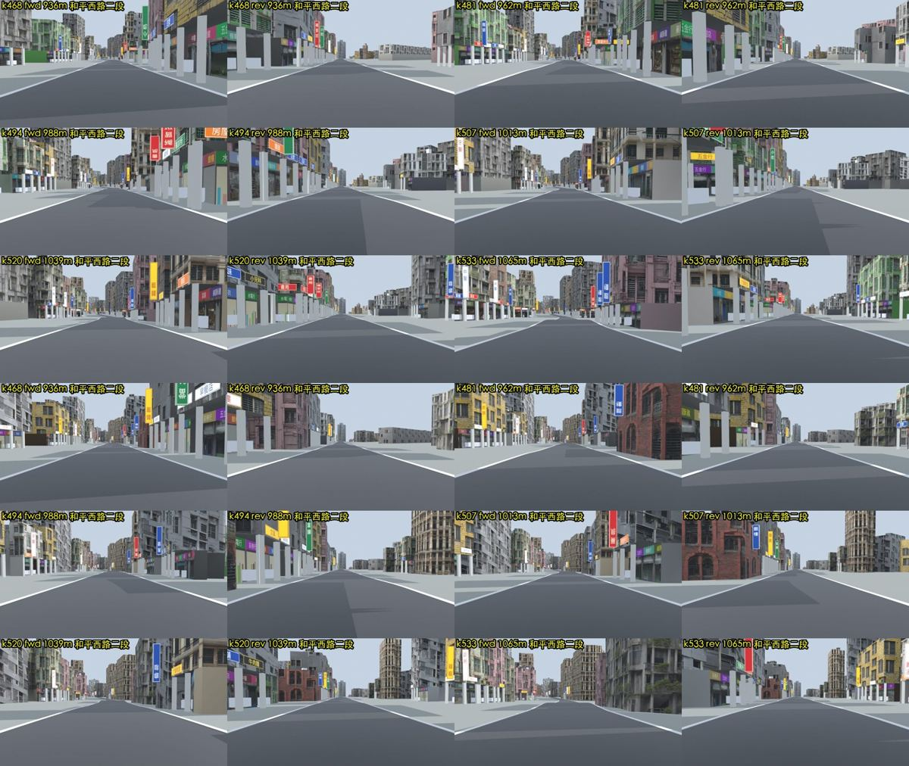
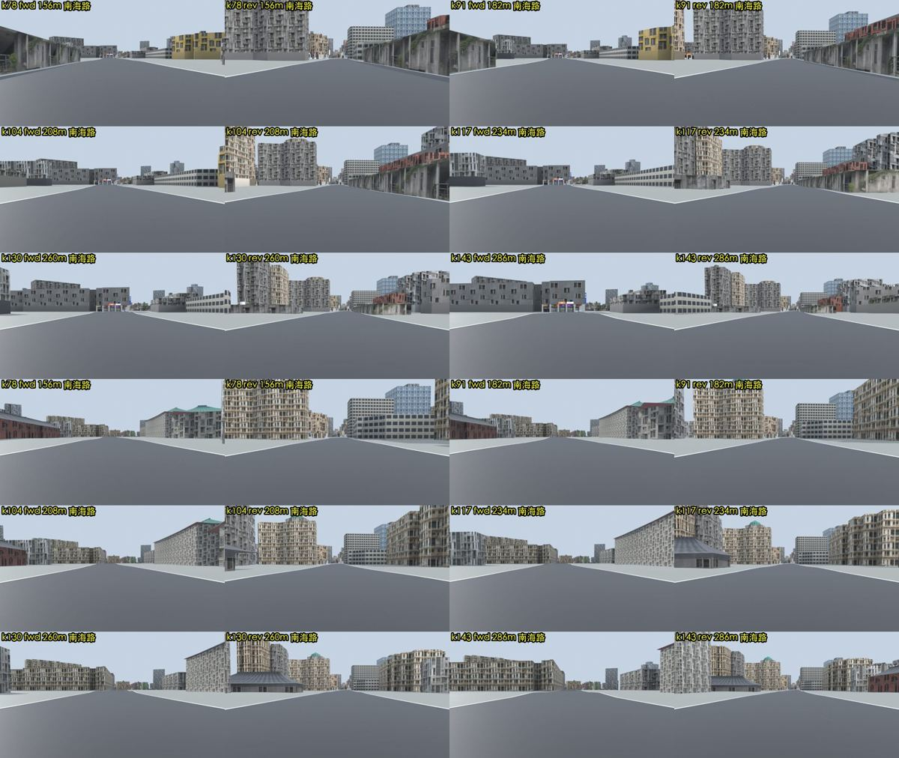
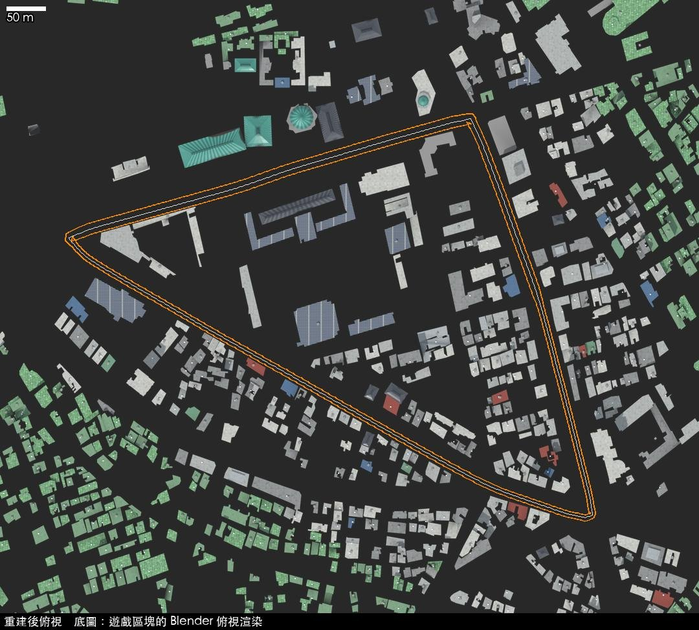

# 建中周邊環線街景修正：進度報告（2026-10-23）

分支 `fix/jianzhong-corridor`（未推送）。範圍：南海路（往西）→ 和平西路二、一段 → 重慶南路三、二段，逆時針 1,847 m，中線左右 150 m 加上環線圍住的街廓；
重建的區塊是 `t_3_3`、`t_3_4`、`t_4_3`、`t_4_4`。問題清單見 `問題清單.md`，參考圖資見 `ref/SOURCES.md`。

## 一、結果摘要

| 指標 | 改之前（A0） | 改之後（A） |
|---|---|---|
| 環線射線：建物在車道（離地 1 m，同 `js/walls.js`） | **19／924** | **0／924** |
| 樓上外牆懸在車道上（4／8 m） | 23 | 0 |
| 騎樓柱站在車道裡 | 2 | 0 |
| 三條預設環線的射線檢查 | 0／0／0 | 0／0／0（預設 1 的 2 條懸空在 `t_2_4`，不在這次範圍，原本就有） |
| 輪廓伸進官方道路用地 > 1 m | 34 棟 | 0 |
| 輪廓被拉過馬路 | 6 棟 | 0 |
| 騎樓內縮輪廓破掉（破圖） | 37 棟 | 0（折疊的改成無騎樓） |
| 兩棟重疊、牆面穿插 | 47 對 | 0 |
| 重疊且屋頂同高（閃爍） | 1 對 | 0 |
| 一棟包在另一棟裡 | 4 對 | 3 對（高低不同的樓層段，是正常的階梯造型，不會閃爍） |
| 輪廓自我交叉 | 10 棟 | 1 棟（走廊邊界外的 tpe3d:9842） |
| 學校／機關／公園內做成騎樓店面 | 43 棟 | 0 |
| 官方建照有、場景沒有 | 35 筆 | 12 筆（都是影像上施工中或空地的基地，刻意留空） |
| 高度 MAE（有樓層的建照） | 7.8 m（17 筆，平均偏低 4.9 m） | 0（40 筆；見下方「循環」說明） |
| 建照輪廓 IoU 平均／重心偏移平均 | 0.20／4.2 m | 0.79／0.6 m（同上，見說明） |
| 標註樣本 50 棟：有無建物 | 42/49 | 47/49 |
| 標註樣本：屋頂類型 | 0/42（全是綠色防水層） | 33/45（73%） |
| 標註樣本：用途 | 32/42 | 44/45 |
| 標註樣本：騎樓（只有能判斷的列） | 7/9 | 11/12 |
| 標註樣本：地標 | 40/42 | 43/45 |
| 另抽 24 棟目視驗證（`validate_sheets.py`，種子 7，和標註樣本不重複） | — | 有無建物 24/24、屋頂 19/24 |
| 路緣和官方人行道邊線差 > 2 m | 30 處 | 30 處（遊戲路線資料，沒改；見待決定事項） |

**循環說明**：A 管線直接拿建照套繪當新建物的輪廓與樓層，所以「建照 IoU」和「高度誤差」對 A 來說不是獨立驗證（IoU 沒到 1 是因為道路淨空裁掉、和走廊外建物的重疊處理）。
獨立的檢查是標註樣本、另抽的 24 棟目視驗證和射線檢查。給其他做法比較時，這兩項只能看「有沒有用上官方資料」。

（上：改之前，正前方是一排橫跨南海路的店面；下：改之後，國小校舍退到車道外、改用校舍立面，左上角歷史博物館有綠色琉璃瓦屋頂。）

## 二、各階段做了什麼

### 1. 問題重現（不開瀏覽器）

使用者要求不開 Google Chrome，而 `tools/test/run.py` 的檢查全部要用 Playwright 開 Chrome，所以另做了一套：

- `tools/test/node/world.js`：在 Node 裡跑真正的 `game.js`（假 DOM、假 WebGL、three.js r128 同版本），輸出中線、車道半寬、路面高度、用到的區塊。
  建中環線結果和 iOS 模擬器實測完全相同（1,847 m、924 條射線、路線摘要一字不差）；三條預設環線的長度、區塊數、`line.js` 的單圈時間（81.6／75.7、59.2／55.0、39.3／35.4 秒，跑出路面 0）和 `tools/test/README.md` 完全一樣。
- `tools/test/blender_walls.py`：在 Blender 裡做和 `js/walls.js` 相同的射線檢查，**重現了 19／924**；另加 4／8 m 懸空與騎樓柱兩項（瀏覽器版看不到用 instancing 畫的騎樓柱）。
- `tools/blender/build_tile.py` 加 `TGP_DUMP`：輸出每棟建物最後真的拿去建模的輪廓與選擇，拿來和官方圖層比對（`tools/jianzhong/audit.py`）。
- Blender 俯視渲染疊正射影像（只在本機比對；repo 裡的圖改用渲染當底圖）、沿線每 25 m 前後街景 144 張（`tools/jianzhong/blender_views.py`）。

### 2. 參考圖資

全部換算成遊戲資料座標（TWD97 TM2 減 E 299000、N 2766400）並裁到走廊（`tools/jianzhong/prep_ref.py`，說明在 `ref/README.md`）：

| 資料 | 授權 | 用途 |
|---|---|---|
| 臺北市建築執照套繪圖（建管處，2026-10-05） | 政府資料開放授權條款第1版 | 2001 年後新建物的輪廓與樓層 |
| 臺北市寬度超過8公尺道路GIS圖資（新工處） | 同上 | 道路用地，建物不能伸進去 |
| 臺北市人行道範圍圖（新工處） | 同上 | 路緣位置、人行道寬 |
| 臺北市道路寬度（都發局） | 同上 | 參考 |
| 臺北市都市計畫使用分區圖 細部計畫（都發局，114 年 1 月） | 同上 | 學校、機關、公園用地 → 用途 |
| 國土測繪中心 PHOTO2 正射影像（2024，z19 約 0.27 m） | **不是開放授權**（國土測繪圖資服務雲使用條款：可公開顯示附來源，不得大量下載） | 只做比對、目視驗證與 VLM 判讀屋頂；沒有進 git、沒有拿來訓練生成模型 |

使用者原本以為正射影像是政府資料開放授權條款，查證後不是，所以收斂了用法（見 `ref/SOURCES.md`）。
內政部三維建物（3D Tiles）、都發局 1/1000 地形圖都有樓層資料，但條款不允許這種用法，沒有用。

### 3. 交叉比對與參數表（訓練 (a)：模型輔助分析）

`tools/jianzhong/derive_params.py` 產生 `data/corridors/jianzhong.json`（418 棟）。規則在程式開頭，重點：

1. **有無建物**：兩個視覺語言模型（Qwen3-VL-32B、Qwen3-VL-8B，Colab）各自判讀每個輪廓的正射影像裁圖；兩個都說「沒有建物／工地」才刪（刪 23 棟，例如躺在南海路上的 tpe3d:9821、樹林上的 2199）。兩個模型的有無判斷 392/491 一致、屋頂 368/491 一致。
2. **新建物**：建照套繪的建物（影像上蓋好了）取代裡面 50% 以上的舊 tpe3d 輪廓（44 筆）；影像上是工地或空地的建照基地清空（12 筆）。
3. **高度**：有建照樓層的用 4.2 + (樓層 − 1) × 3.2 m，其餘沿用 tpe3d。
4. **道路淨空**：輪廓減掉「官方道路用地 ∪ 遊戲環線車道 + 1.5 m ∪ 其他 OSM 道路（同原本 `clear_roads` 的寬度）」。
5. **重疊**：由高到低依序接受，後面的扣掉前面已占的範圍。
6. **屋頂**：模型判讀（信心 ≥ 0.5，兩個模型不一致時信心減半），不夠時用影像顏色規則。
7. **用途**：使用分區是學校、機關、郵政、公園、保存區 → 機關；模型看到廟宇 → 宗教；其餘依騎樓規則與臨路寬度分店面／住宅。
8. **騎樓機率**：臨 ≥ 15 m 道路且外牆貼著道路用地 +0.45、12–15 m +0.25、高 ≥ 10 m +0.2、前面沒有 2 m 以上人行道 +0.1、機關用地 −0.7，≥ 0.5 有騎樓（114 棟）。這是事先定的經驗規則，正射影像看不到騎樓，只有 12 列標註能核對。
9. **地標**：第二輪用 32B 模型只看公共建物與 OSM 地標的屋頂形狀（57 張）。國立歷史博物館判成綠色琉璃瓦歇山頂、臺北當代工藝設計分館兩棟是圓頂、tpe3d:5801 是深灰瓦斜屋頂。
   **建中紅樓 = tpe3d:5801 是我手動指定的**（高中用地裡、南海路校門後唯一的斜屋頂老建築；第二輪模型獨立判為深灰瓦斜屋頂，和推定一致），沒有官方資料可以核對名稱。

驗證（使用者要求的「隨機抽樣目視」）：另抽 24 棟（和標註樣本不重複），對正射影像逐張看（抽查圖含正射影像，留在 repo 外的 `work/validate/`）：建物都在（24/24），屋頂 19/24 一致；不一致的 5 棟都是「一個輪廓包好幾間、屋頂有鐵皮也有水泥」，參數表給了水泥。

**我看過哪些標註**：`eval/labels.csv` 的 50 棟是我自己判讀的，建管線時看過全部 50 張裁圖。參數規則沒有用標註調整；只有第 10 條「公共用地上的瓦屋頂當宮殿式」是第一次模型判讀後、評分前加的（依據是南海學園的建築型式，不是標註分數）。

### 4. 貼圖 LoRA（訓練 (b)）：沒有訓練

建中周邊找不到授權乾淨的立面影像，詳見 `貼圖LoRA評估.md`。改用限縮做法：立面沿用既有 AI 貼圖但依用途分配（學校用校舍立面、紅樓用老紅磚），屋頂新增 10 張程式繪製貼圖。
要做真正的在地 LoRA，需要使用者自己沿環線拍一趟（例如 Insta360 X5），去識別化後約 300–600 張立面塊，Colab L4 約 3–4 運算單元。

### 5. 重建

`build_tile.py` 擴充（沒有另寫一套）：

- 讀 `data/corridors/*.json`：範圍內（與 `replaces` 列出的）`data/taipei.json` 建物改用走廊參數；屋頂、騎樓、店面、招牌、機車、冷氣依參數決定；OSM 地標可由參數改高度與屋頂（綠色琉璃瓦、深灰瓦、圓頂）。
- **全域修正**（之後重建任何區塊都適用）：`clear_roads()` 把頂點推回建物自己那一側（不再推過道路中線）；騎樓內縮輪廓折疊時改成不做騎樓。
- `make_textures.py` 新增水泥平頂三種、鐵皮四色、太陽能板、綠色琉璃瓦、深灰瓦。共用貼圖（招牌、店面等）維持 repo 原檔，因為 `make_textures.py` 的亂數輸出和原本不同，重產會讓全地圖的招牌字改變。
- 只重建 4 個區塊，`models/taipei/tiles.json` 不動（範圍沒變）。重建流程：`tools/jianzhong/rebuild.sh`。
- 建中校園只做從公開道路看得到的外觀：校舍用一般校舍立面，沒有做校園內部細節。

### 6. 驗證

- 射線檢查：環線 0／924；三條預設環線 0（Blender 版）。
- `python3 tools/test/run.py quick`：**沒有跑**，四項（walls、line、ai、envelope）都要用 Playwright 開 Chrome，違反使用者的要求。替代：
  - walls → `blender_walls.py`，結果如上。
  - line → Node 版跑 `js/line.js`，三條預設環線和 README 完全相同（這次沒改 `game.js` 與 `data/taipei*.json`，行車線本來就不受區塊影響）。
  - ai、envelope → 沒跑。兩者只用 `game.js` 的物理與賽道資料，不讀區塊，這次沒改到。Node 版的 envelope 因為假 DOM 的設定值和瀏覽器不同，數字和 README 對不上，不能當替代。
- iOS 模擬器的遊戲畫面：沒有做。App 已移除建中環線，又不能改 App 的 repo；街景改用 Blender 渲染。

## 三、Colab 用量

| 工作 | GPU | 時數 | 帳本記錄 |
|---|---|---|---|
| jzroof8b（Qwen3-VL-8B，491 張） | L4 | 0.58 | 6.81（餘額相減，和同時段另外兩台 VM 重疊；依 L4 費率約 0.9） |
| jzroof32b（Qwen3-VL-32B，491 張） | A100 80GB | 0.71 | 4.79 |
| jzroofshape（32B，57 張） | A100 | 0.12 | 0.47 |
| 合計 | | 1.41 | 帳本 12.07；實際約 6.2 |

三台都已關機（`colab_job.py sweep` 確認，我開的沒有留著）。

## 四、待決定事項

1. **南海路的行駛中線偏南約 6 m**（OSM 資料）。遊戲車道南側約 5.5 m 壓在國小、建中的圍牆位置，所以那一側的校舍只能退到遊戲車道外，看起來比實際更退縮。要修得改 `data/taipei_osm.json`（`tools/prep_taipei_osm.py`）的南海路幾何或寬度，會影響所有經過南海路的路線，需要另一個對話決定。重慶南路三段的遊戲車道也比實際窄 2–3 m。
2. **正射影像授權**：參數表裡「屋頂類型、有無建物」是從國土測繪中心正射影像判讀的事實，原圖沒有散布。這樣放進公開 repo 是否可以，或要改向國土測繪中心申請授權，請使用者決定。文件裡的套疊圖都有標示來源（條款允許公開顯示）。
3. **建中紅樓的指定**是推定；需要校方或使用者確認位置，也需要校方同意才能在 App 放校名賽道（iOS 端的既有決定）。
4. **建中環線要不要加回預設環線**：這次只把它放在測試（`eval/track_loop.json`），沒有加進 `TP_CIRCUITS`。
5. **在地立面 LoRA** 要不要拍攝素材（見 `貼圖LoRA評估.md`）。
6. **`tools/test/` 的不開瀏覽器版本**要不要收進正式測試（`node/world.js`、`blender_walls.py`），讓 `run.py` 多一個不需要 Chrome 的模式。
7. 預設環線 1（萬華艋舺）在 `t_2_4` 有 2 條 8 m 高的懸空射線（`buildings_facade_ai_concrete`），不在這次範圍，留給另一個對話。

## 五、產出檔案

| 檔案 | 內容 |
|---|---|
| `data/corridors/jianzhong.json` | 走廊建物參數（build_tile.py 讀） |
| `models/taipei/t_3_3`、`t_3_4`、`t_4_3`、`t_4_4`、`tex/roof_*`、`tex/tile_green`、`tex/tile_slate` | 重建的區塊與新屋頂貼圖 |
| `tools/blender/build_tile.py`、`make_textures.py` | 擴充與修正 |
| `tools/jianzhong/*` | 參考圖資、套疊、街景、問題清單、參數推導、重建、驗證工具 |
| `tools/colab/roof_vlm_job.py` | VLM 判讀（Colab） |
| `tools/test/node/world.js`、`tools/test/blender_walls.py` | 不開瀏覽器的賽道幾何與射線檢查 |
| `eval/` | 評分程式、標註樣本、A0／A 的參數與結果（給其他做法比較） |
| `docs/jianzhong/` | 問題清單、本報告、LoRA 評估、PR 說明、前後對照圖 |
