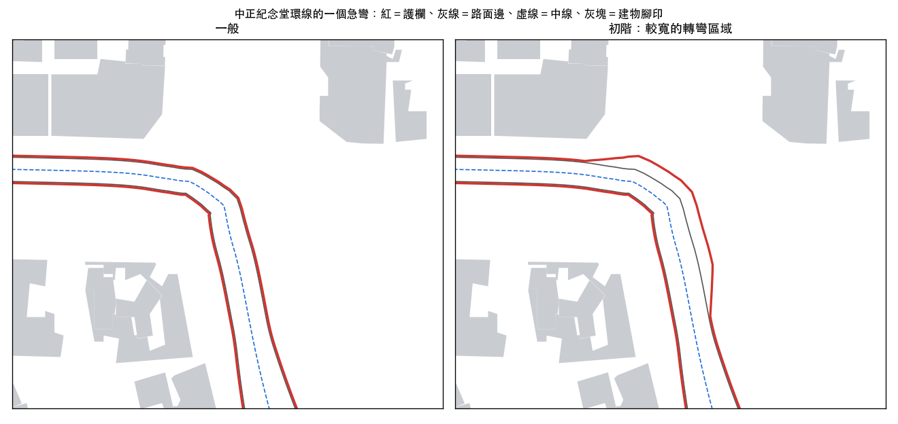

# 急彎護欄、初階較寬轉彎區域、艋舺大道路寬（2026-10）

分支 `feat/corners-2026-10`，接在 PR #27（`docs/賽道修正_2026-10.md`）之後，處理它第八節留下的問題與使用者的建議「或是提供初階較寬的轉彎區域」。

## 一、結果

物理稽核（`python3 tools/test/physaudit.py --set full`，四條賽道 × 11 個情境，亂數固定）：

| 賽道 | 瞬移（次） | 穿過護欄最深（m） | 不通過項目 |
|---|---|---|---|
| 中正紀念堂環線 | 1 → **0** | 0.7 → **0** | 1 → **0** |
| 萬華艋舺環線 | 2 → **0** | 0.2 → 0.1 | 2 → **0** |
| 大安仁愛短程 | 0 → 0 | 0.7 → **0** | 0 → 0 |
| 校園周邊環線（未啟用） | 9 → 1 | 2.8 → 0.8 | 6 → 4 |

（「→」左邊是 PR #27 合併後的 main。）三條預設環線的瞬移與穿過護欄都是 0；`run.py quick --no-browser` 全過。射線檢查（到護欄 − 1 m）四條賽道 0，開啟「初階：較寬的轉彎區域」後四條賽道也是 0。

## 二、急彎的瞬移與穿過護欄：成因與修法

**成因**：護欄是每個中線取樣點左右各一個「護欄位置」，碰撞時拿車子對最近取樣點的橫向位置和該點的護欄位置比。路口急彎（例如校園環線南海路轉和平西路，8 m 內轉 110°）外側的楔形區，最近的取樣點會在兩段路之間跳換；換到另一段時，同一個位置的橫向距離可能一下子超過那一點的護欄 2～8 m，物理就一步把車推回去（稽核的「瞬移」），也會在換點的那一格量到穿過護欄。撞擊時的 0.6～0.7 m 也是同一件事：碰撞用的是移動前的取樣點，車已經移到下一點、護欄位置不同。

**修法**（`game.js` 的 `wallContact()`）：

- 彎外側與直線：護欄是相鄰取樣點的護欄點連成的**連續折線**，量車子中心到折線的距離，推回的方向是折線的法線。路寬變化、急彎外側都連續，不會跳。
- 彎內側（|曲率| > 1/150）：偏移線會摺回（內側半徑小於護欄偏移），折線在那裡會橫過車道，所以維持原本「最近取樣點的橫向位置」量法；那裡不會有楔形區。
- 玩家被電腦車推擠後的護欄檢查用同一個函式。
- 物理稽核的「穿過護欄」改用同一條折線量（舊版 game.js 沒有這個函式時用舊量法）。

**校園環線剩下的**：南海路轉和平西路是一個 110° 的折角（路網的路口本身），車子貼內側時最近取樣點一次跳 7～8 點（稽核「索引跳動」），電腦車對撞時有一次 1.7 m 的推回，「貼左牆」機器人在折角處繞圈超過 3 秒（之後自己脫困）。要根除得把路線在路口的折角改成有半徑的轉彎（會改變賽道），這條環線未啟用，先列為待辦。

## 三、初階：較寬的轉彎區域

設定頁「賽道」多一個勾選「初階：較寬的轉彎區域」，**預設關**，會記在偏好設定裡。

- 半徑 < 45 m 的彎，外側護欄在彎前 10 m 到彎後 30 m 往外移，最多 4 m（臺北）／6 m（其他地圖）。
- 移多少看有沒有空間：建物佔用格（已和 3D 一致，見 D3）、別段賽道、地圖邊界；護欄後方留 2 m。前後以 1:4 漸變。
- 多出來的區域鋪成柏油緩衝區（畫在人行道上方），物理上算柏油路面，不是減速的人行道。


- 三條預設環線各多出約 230～250 m 長、平均 3 m 寬的緩衝區（最寬 4 m）。
- 賽道 id 加 `_wide`（例如 `taipei-2610-1fqdctv_wide`），最佳圈與排行分開；線上房間會把這個設定傳給加入的人。
- 電腦車的行車線與速度不變（緩衝區只給玩家救車用）。
- 稽核的機器人不是新手（照中線開或刻意貼牆），撞牆次數看不出差別（四條合計 625 → 600），這個選項的效果要實機給新手試；稽核確認的是開啟後不穿牆、不進建物、沒有瞬移。

## 四、艋舺大道路寬

PR #27 沒加寬艋舺大道：主要那條 OSM way 有幾段右側路緣離中線只有 2.5～5 m。

- `tools/taipei_overrides.py` 新增 `"pieces"`：沿行駛方向在指定點把 way 切開（切點兩段共用，路網照樣相連），每段各自的寬度；重複執行會先刪掉上次切出的段再還原。
- 艋舺大道 4 條 way 切成 10 段：右側路緣不到 5.4 m 的段落維持 7.9 m，其餘依該段每 25 m 剖面右側路緣最近距離 ×2（留 0.2 m）：14.5、10.0、16.0（上限）、12.0、16.0 m。中位數 7.9 → 11.5 m。
- 重建 4 個區塊（t_0_3、t_1_3、t_1_4、t_2_4，其中 2 個內容有變），射線 0。

## 五、最佳圈

2026-10 路寬修正讓三條預設環線的賽道 id 變了。`loadBest()` 加了舊 id → 新 id 的對應：

| 環線 | 新 id | 讀得到的舊 id |
|---|---|---|
| 中正紀念堂 | `taipei-2610-1fqdctv` | `taipei-2610-fo6wqn`（PR #27 之前） |
| 萬華艋舺 | `taipei-1685-1rizzf` | `taipei-1685-1p875b5`（PR #27）、`taipei-1685-1jdwle7`（之前） |
| 大安仁愛 | `taipei-964-1tiakky` | `taipei-964-xial2w`（之前） |

取樣點數相同，所以逐點時間與幽靈車也還能用；反向行駛的點數變了，不對應。下次跑出更快的圈就存在新 id 下。

## 六、iOS

CampusRacer 頻道 `corners`（這個分支 6af92afea）。同步前重跑 `tools/build_fonts.py`：字型子集 1,076 字（Noto Sans TC 子集 0.41 MB），同步不再警告缺字。

| 項目 | 結果 |
|---|---|
| 模擬器自我測試（Debug） | 34 項全過；中正紀念堂環線建立 1.0 秒、萬華 0.6 秒 |
| **iPhone 18 Pro 實機跑分**（Release、Wi‑Fi、低耗電模式關、溫度 fair） | 省電 **60.0／48.7**、平衡 **60.0／45.7**、高畫質 **60.0／49.3**（平均／1% low fps）；平衡那一場「遊戲秒／實際秒」0.91（中途有一次停頓，行駛 2,698 m，其餘兩場 1.00） |
| iPhone 18 Pro 實機自我測試（Release） | 34 項全過；中正紀念堂環線建立 0.7 秒、萬華 0.5 秒、丘陵 0.6 秒；平均 60.0 fps、1% low 47.8 |
| 安裝 | Release 版已裝在 iPhone 18 Pro（跑分與自我測試用的就是這一版） |

## 七、重現

```
python3 tools/test/physaudit.py --set full --loop '[[2915,3002],[2700,2962],[2470,2878],[2760,2655],[3050,2510],[2995,2760]]'
python3 tools/test/physaudit.py --set full --setup '{"wideCorners": true}'
python3 tools/test/run.py quick --no-browser
python3 tools/taipei_overrides.py --check
```
