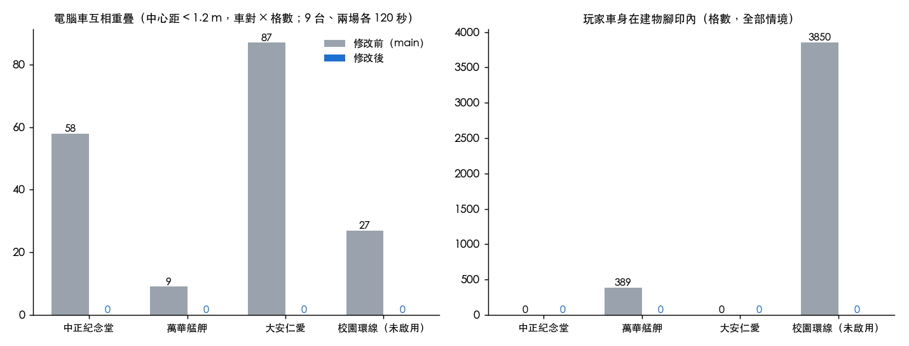
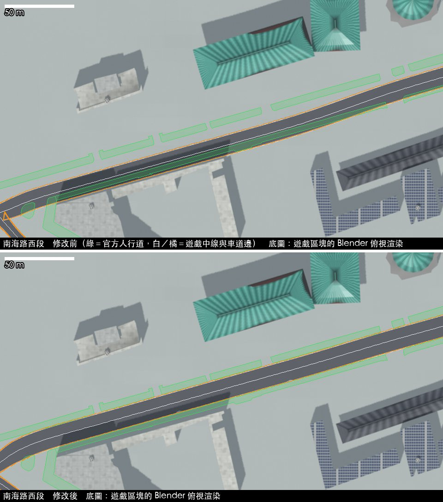

# 賽道修正 2026-10（P1–P7、D1–D7）

分支 `feat/track-fixes-2026-10`，從合併 PR #26（`fix/streetview-audit`）後的 main 切出。問題清單見〈terrain-gp 賽道設計問題彙整_2026-10-24〉（repo 外）。

## 一、結果一覽

物理稽核（`python3 tools/test/run.py phys`，Node 跑真正的 game.js，不開瀏覽器；四條賽道 × 11 個情境，亂數固定）：

| 賽道 | 電腦車互相重疊（中心 < 1.2 m，車對×格數） | 玩家車身在建物腳印內（格數） | 垂直頂牆、自動油門 | 起跑格卡住（種子 8） | 稽核不通過項目 |
|---|---|---|---|---|---|
| 中正紀念堂環線 | 58 → **0** | 0 → 0 | 卡死 → **5.6 秒脫困** | 2 次 → **0** | 4 → 3 |
| 萬華艋舺環線 | 9 → **0** | 389 → **0** | 2.2 秒（此處本來就出得來） | 0 → 0 | 14 → 2 |
| 大安仁愛短程 | 87 → **0** | 0 → 0 | 卡死 → **5.6 秒脫困** | 0 → 0 | 5 → 2 |
| 校園周邊環線（未啟用） | 27 → **0** | 3,850 → **0** | 卡死 → **5.7 秒脫困** | 0 → 0 | 22 → 6 |



- 射線檢查（`tools/test/blender_walls.py`，射線從路緣延伸到「護欄 − 1 m」）：四條賽道 **0**（修改前用新範圍量也是 0）。
- 一般駕駛 60 秒行駛距離不變（3,401／2,985／2,538／2,497 m → 3,399／2,988／2,539／2,504 m），中線一圈 91.3／69.4／44.4／43.0 秒，和修改前相差 0.1 秒以內。
- 低幀率（12 fps、每格上限 0.05 秒）120 秒只跑 4,031 m；上限改 0.1 秒後 6,870 m，和 60 fps 的 6,884 m 一致（P4）。
- `python3 tools/test/run.py quick --no-browser`：物理稽核短版＋ P1／P2 回歸測試，見第五節。

## 二、物理與碰撞

### P1 電腦車之間的間距（`separateOpponents`）

電腦車不是剛體，在賽道座標（沿中線的 `s`、橫向 `lat`）裡移動，所以間距也在賽道座標裡處理：每格（`opponentsStep` 結尾）把出發後的電腦車依 `s` 排序，檢查前後一、二台；長 4.6 m × 寬 2.0 m 重疊時，旁邊有空間就各往外推一半（每秒最多 3 m），沒空間就讓後車退後並降到前車速度的 0.95 倍。推完重新擺位，玩家碰撞（`bump()`）用的是新位置。

實作由協作 AI 依規格撰寫，整合時改了四處（見第四節）。其中兩處是真正的幾何問題：

- 在急彎內側，沿中線的 `s` 和實際距離不同；改用該處偏移線的實際長度換算。
- 路口急彎的內側偏移線會摺疊（往回走），兩台 `s` 差 8 m 的車會疊在同一點（校園環線第一個彎）。每個取樣點算出偏移線仍往前走的最大橫向位置，電腦車不進入摺疊區。

玩家車被電腦車推擠時，以前會被推過護欄（大安仁愛起跑 1.2 m）；`bump()` 推完現在會停在護欄內。

### P2 自動油門貼牆脫困（`autoRecover`）

自動油門開啟、在比賽中：油門 > 0.5、速度 < 0.8 m/s、碰著護欄持續 1.2 秒 → 倒車（最多 1 秒；完全不動就延長到 2 秒）→ 離開 2.5 m 或車頭和賽道方向差 < 35° 就回 1 檔；倒車 2 秒仍不動就 `resetToTrack()`。玩家自己打倒檔、按重置或踩煞車時立刻交還控制。手動油門（自動油門關）完全不介入：稽核的「垂直頂牆（手動油門）」仍然卡住，是刻意的。

**起跑格卡住（種子 8）**：高度取樣分支找到的「中正紀念堂起跑格、油門 1、1 檔、0 km/h、旁邊沒有車」，追下去是玩家車在起跑後被電腦車擠到左側護欄、車頭與賽道方向差超過 90°；護欄碰撞只在 90° 以內幫忙把車頭轉回，所以車一直頂著牆。這就是 P2 的情況，整合 `autoRecover` 後 8 秒倒車、10.5 秒繼續上路。已加成回歸情境（`physaudit.py` 的第一個情境「電腦車9台故意撞 種子8」，必須在新建好的世界上跑才會重現）。

### P4 每格時間上限

`frame()` 的上限 0.05 → 0.1 秒（`MAX_DT`，`window.TGP_MAX_DT` 可覆寫），物理仍是固定 1/240 秒步長。CampusRacer 的 G7 修補在上游已內建時自動略過。

### P5 牆面射線延伸到車子可到的範圍

`tools/test/js/walls.js`（瀏覽器）與 `tools/test/blender_walls.py`（Blender）的射線從路緣延伸到「護欄 − 1 m」（車子中心被擋住的位置；路寬 + 0.5 − 1.0），不足路緣時仍量到路緣。`TGP_RAY=kerb`／`walls.js` 的 `{kerb: true}` 可回到舊範圍比較。`node/world.js` 的輸出多了 `wallL`／`wallR`。

另外：道路變窄處的護欄原本會在相鄰取樣點之間跳 2 m 以上，車貼著護欄開過去會被一次推開 2 m（稽核的「瞬移」與「穿過護欄」）。`realWidths()` 現在讓路面以 1:10 漸變變窄（只會提早變窄，不會變寬），萬華起終點的最大穿越 2.2 m → 0.2 m。

### P6 稽核工具收回上游

CampusRacer 的 `tools/physaudit/` 搬成 `tools/test/physaudit.py`＋`tools/test/js/physaudit.js`，用法見 `tools/test/README.md`。新增：固定亂數種子、電腦車停住／跳動、頂牆脫困、手動油門對照、穿過護欄的最大深度與位置、`run.py phys` 與 `run.py quick --no-browser`。

## 三、街景與資料

### D1／D2 道路中線與路寬（`data/taipei_overrides.json`）

`tools/streetview/road_widths.py` 沿賽道每 25 m 切一條橫剖面，交臺北市「寬度超過 8 公尺道路 GIS 圖資」的道路用地、扣掉「人行道範圍圖」，得到官方路緣；雙向分隔道路（遊戲只開一側）用兩種方式估半幅寬度（右側路緣距離 × 2、全寬減對向中線距離），兩者相差 2 m 內才採用。

- **南海路**：遊戲中線往北移到官方車道中間（西段約 6.5 m、東段約 2 m，依每 25 m 的剖面內插，兩端 25 m 漸變；路口節點連同共用它的道路、號誌一起移），寬 14.3 → 15.5 m。修改後中線偏差 −4.5 m → +0.1 m。



（同一組街景區塊；深色帶是遊戲的車道。修改前南側車道壓在學校圍牆與校舍上、北側人行道前空出約 4 m；修改後車道落在兩側官方人行道之間。）

- **路寬**：13 條 way，每條取「右側路緣離中線最近的距離 × 2 − 0.4 m」（至少 4 處剖面）：新生南路二段 11.1／14.3 → 18.0 m、羅斯福路二段 11.1 → 13.0／15.0 m、中華路二段 9.4 → 13.0／13.5 m、西藏路 7.9 → 10.5／11.0 m、金山南路一段 11.1 → 12.5 m、重慶南路三段 7.9 → 11.5 m。
- 第一版用整段中位數（艋舺大道 16 m）時，萬華有 6 條射線撞到建物：中位數會蓋過路緣突出的地方，所以改成逐條 way 取最窄處。**艋舺大道沒有加寬**：主要那條 way 有一段右側路緣離中線只有 2.5 m（公車停靠區或 OSM 中線偏移），要加寬得先把 way 切段，列為待辦。
- 套用的地方是產生道路資料的 `tools/prep_taipei_osm.py`（最後一步呼叫 `tools/taipei_overrides.py`）。原始 OSM 抽出檔不在這台電腦，所以現有的 `data/taipei_osm.json` 用 `python3 tools/taipei_overrides.py` 套用；原本的道路紀錄存在檔內 `overridden.orig`，重跑會先還原再套用，結果永遠是「OSM 原始資料＋目前的修正檔」。修正以「名稱＋沿線幾何」比對，不靠 way id，重抓 OSM 也對得上。
- 受影響的 16 個街景區塊用 `build_tile.py` 重建（建中與三條環線的走廊建物已依官方道路用地退縮，不受路寬影響；4 個區塊內容有變）。重建會順帶重新編碼共用貼圖 `models/taipei/tex/`，內容同版面，已還原成原檔。
- 路寬改變會改變賽道 id（`trackId()` 依幾何雜湊），三條預設環線之前存的最佳圈不會再顯示。

### D3 小地圖與行道樹用的建物腳印

`build_tile.py` 每次建置都寫出該區塊的最終腳印（`<tile>.foot.json`：退縮道路、走廊參數、刪掉的建物都已處理），`tools/blender/footprints.py` 合併成 `models/taipei/footprints.json`（20 個重建過的區塊、7,789 棟）。遊戲載入臺北時，中心落在這些區塊內的 `data/taipei.json` 建物改用最終腳印，所以小地圖、行道樹的佔用格和 3D 一致；萬華轉角 4126 號（E 2017／N 3265）已不在。稽核的「車身在建物內」萬華 389 格 → 0、校園環線 3,850 → 0。其餘 28 個區塊還是舊版建置，沿用 `data/taipei.json`。

### D7 丘陵練習場固定種子

`randomTrack()` 原本就用 mulberry32，問題在呼叫端用 `Math.random()` 當種子。現在預設「標準丘陵 A」（種子 20261024，4,603 m），設定頁「賽道種子」可輸入任何種子，「隨機賽道」會換一個新種子並顯示；賽道 id 為 `hill_<種子>`（反向加 `_r`；地形或路寬等設定不是預設值時再加幾何雜湊），最佳圈分開記。線上房間會把種子一起傳給加入的人。在地圖上改動控制點後就不再是種子賽道。

## 四、外包程式（協作 AI）的檢討

規格在〈外包任務_給協作AI_2026-10-24〉，回傳兩個檔案各附 4 個自測情境，原樣都通過。拿到真正的 game.js 驗證後：

| 項目 | 問題 | 怎麼改 |
|---|---|---|
| B：碰牆訊號 | `raceUpdate()` 每格最後把 `car.hit` 歸零，`readInput()` 在下一格開頭才跑，`autoRecover` 讀到的永遠是 0，**原樣整合時從來不會觸發**（稽核：頂牆三條賽道照樣卡死） | `physicsStep()` 碰牆時記下 `car.wallT`，0.25 秒內算碰著 |
| B：入倒檔 | 遊戲的 `shift(-1)` 最低只到 1 檔（倒檔只能靜止踩煞車 0.6 秒進入），`while (gear > -1) shift(-1)` 什麼都沒做 | 車已靜止，直接設 `gear = -1`；回 1 檔也直接設 |
| B：倒檔油門 | 倒檔時 `physicsStep()` 把煞車踏板當倒車油門、油門當煞車；`gearLogic()` 看到油門 > 0.3 會切回 1 檔。照規格 `thr = 0.7` 會變成踩煞車並馬上切回 1 檔 | 倒車時 `brk = 0.7`、`thr = 0` |
| B：方向盤 | 規格「`lat > 0` 往右打」是以前進的方向想的；倒車時車頭反而轉向護欄（稽核：頂牆後倒了 2.5 m 又撞回去，一直循環） | 方向相反（`REC_STEER`），三條賽道 5.6～5.7 秒脫困 |
| B：玩家接手 | 只看檔位 | 倒車中玩家踩煞車也算接手 |
| A：彎道內側 | `s` 是沿中線的距離，急彎內側 8 m 的 `s` 差可能只有不到 1 m 的實際距離，原樣整合後重疊大幅減少但沒有歸零（9 台 120 秒、種子 1：中正 45 → 0、萬華 9 → 3、大安 77 → 4、校園 31 → 25；剩下的都在急彎內側） | 依偏移線幾何換算距離；避開內側摺疊區 |
| A：後退瞬移 | 沒空間時後車一步退到「前車 − 4.6 m」，最多跳 4.6 m | 每秒最多退 6 m，但不讓中心距小於 1.25 m |
| A：其他 | 排序、跨起終點、3 m/s 橫向上限、不動玩家與 AI 決策欄位都正確；`pairKey = p1*32+p2` 在 ≤ 20 台時沒問題 | 不變 |

自測的盲點：兩份測試都用自己寫的假環境（假 `shift()`、每步不清 `car.hit`、油門直接決定倒車速度、直線賽道），剛好避開了上面每一個問題。回歸測試 `tools/test/node/opponents_test.js`、`recover_test.js` 保留它的四個情境，但改成直接從 game.js 取出程式來測，假環境照遊戲的規則（每格清 `car.hit`、用遊戲的 `shift()`、倒檔用煞車踏板）；A 的情境 2 改成「一格內至少拉開 1.25 m、一秒內拉開 4.6 m」。整體來說，它的程式結構與邊界處理寫得清楚、規格內的部分正確，錯在規格沒寫到的遊戲行為；這類工作外包時，規格要附上會互動的既有函式原文，驗收要在真的遊戲裡跑。

## 五、手機效能（P7）

| 項目 | 改法 |
|---|---|
| 街景小物件（冷氣、鐵窗、招牌、機車）顯示距離 | 寫死 450 m → 依畫質：手機 高 300／中 150／低 120 m（自動畫質最低兩級再縮為 80、53 m），桌機維持 450 m；`window.TGP_DETAIL_R` 可覆寫 |
| 分段建立 | 地面、賽道路面、路緣、護欄、起跑門先建；城市街道、一般建物、行道樹、路燈號誌、公園地標、遠方天際線改成倒數時每格做一兩件（`runLater`）。街景區塊先載入起跑 800 m 內的，其餘手機 2 條、桌機 4 條依序載入 |
| 行車線求解 | 陣列快取，結果逐位元相同，中正紀念堂 269 → 188 ms（Node） |
| 反鋸齒 | 依存下的畫質決定（高：開；低：關；中／自動：桌機開、手機關）；換畫質後提示重新載入 |
| 陰影 | 手機只有「高」開陰影 |
| 自動畫質 | 手機：1 秒平均低於 50 fps（> 20 ms）連續 4 秒就降一級；桌機維持 95 百分位 > 22 ms |

Node 量測（無 WebGL，只算 CPU）：中正紀念堂環線建立時，延後的工作約 55 ms；主要 CPU 時間在行車線（已優化）與地形挖路。實機的 7.5～8 秒大部分是 GPU 上傳、著色器編譯與街景區塊解碼，分段建立的效果要看實機數字（第六節）。

## 六、iOS 驗證

CampusRacer 加了頻道 `trackfixes`（`GameWeb/pins.json`，指向這個分支），`tools/sync_game.py` 的錨點 8＋10 處全部對上（G7 的每格上限修補在上游已內建，自動略過）。

| 項目 | 結果 |
|---|---|
| 模擬器自我測試（Debug，共用模擬器 iPhone 18 Pro） | 34 項全過；開賽 1.1 秒；中正紀念堂環線建立 1.4 → **1.1 秒**（同一台模擬器、`fix/streetview-audit` 是 1.4 秒）；四條賽道射線 0；丘陵 4,603 m |
| 模擬器跑分（Release） | 省電／平衡／高畫質 60.0／60.0／60.0 fps（1% low 44.2／49.0／47.1），模擬器只看趨勢 |
| 實機 iPhone 16 Pro 跑分（Release，Wi‑Fi） | 省電 **51.1／36.4**、平衡 **48.8／34.9**、高畫質 41.5／28.7（平均／1% low）；低耗電模式關、溫度 nominal；街景分支同機 51.2／34.8、49.1／35.0 |
| 實機 iPhone 16 Pro 自我測試（Release） | 34 項全過；開賽 1.0 秒；中正紀念堂環線建立 **0.9 秒**、萬華 0.5 秒、丘陵 0.8 秒；平均 54.4 fps |
| 實機 iPhone 18 Pro | 這次一直是「unavailable」（不在同一個 Wi‑Fi 或螢幕鎖定），沒有跑分也沒有安裝 |

App 的「省電／平衡」本來就自己藏掉街景小物件、關反鋸齒（CRInject），所以這次上游的小物件距離、反鋸齒與陰影預設在 App 裡看不出 fps 差異；它們影響的是瀏覽器版手機。App 端看得到的是建立時間（分段建立＋行車線加速）。

注意：同步時 App 的字型子集少了這次新增介面文字用到的字（例如「種」「鋸」「齒」「漸」「窄」），要在 CampusRacer 跑 `python3 tools/build_fonts.py`；目前會退回系統字型顯示。

## 七、選用賽道包

`data/trackpacks/`（格式見其 README）。遊戲只載入 `game.js` 的 `TRACK_PACKS` 列出的檔案（預設空），沒列出的賽道包不會被下載，選單也不會出現；臺北的賽道包賽道會加在「臺北預設環線」最後。`campus_a.json` 是一條校園周邊環線（1,862 m，逆時針），名稱只寫「校園周邊環線」，**未啟用**；取得校方書面同意後，把 `TRACK_PACKS` 改成 `['data/trackpacks/campus_a.json']` 一行即可。稽核與射線檢查已把它當第四條賽道。

## 八、仍待處理

（第 1、2 點已在 `feat/corners-2026-10` 處理，見 `docs/急彎護欄與初階寬彎_2026-10.md`。）

1. **路口急彎的瞬移與穿過護欄**（修改前就有）：校園環線南海路／和平西路口、重慶南路／南海路口，中正紀念堂逆向過起點，萬華起終點（艋舺大道），車貼著護欄或全速撞進彎時會被推 2～4 m（稽核「瞬移」「穿過護欄」）。成因是急彎處 `trackLocate` 換到另一側取樣點、護欄位置隨之跳動；需要另外處理彎內護欄的連續性。高速撞牆 0.6～0.7 m 的穿越在 main 上也一樣。
2. 艋舺大道加寬需要先把 OSM way 切段（見 D2）。
3. 其餘 28 個街景區塊還是舊版建置，小地圖沿用 `data/taipei.json`；整張地圖重建一次就會全部一致。
4. 校園環線的啟用需要校方書面同意。
5. D4（騎樓與一樓用途）、D5（行道樹）、D6（屋頂）要等 X5 補拍或授權決定，這次沒有動。

## 九、重現

```
python3 tools/test/run.py quick --no-browser
python3 tools/test/physaudit.py --set full --loop '[[2915,3002],[2700,2962],[2470,2878],[2760,2655],[3050,2510],[2995,2760]]'
python3 tools/streetview/road_widths.py out.json <world.js 輸出的賽道>...     # 需要 ref/raw 的官方圖資
python3 tools/taipei_overrides.py --check
blender -b --factory-startup --python tools/test/blender_walls.py -- . out.json <world.js 輸出的賽道>...
```
