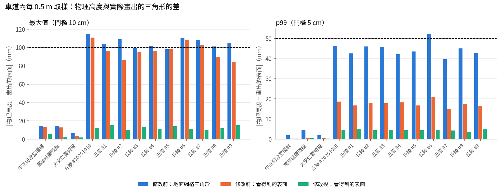
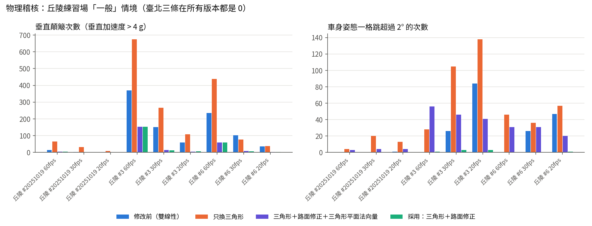

# 高度取樣與地圖模式檢查（2026-10-24，分支 fix/height-sampling）

這份報告檢查三件事：車子的物理高度和畫面上的路面對不對得上；OpenStreetMap 匯入與自訂高度圖的座標換算；Terrarium 高度圖的解碼。三件都在 Node 裡跑真的 `game.js`，沒有開瀏覽器。量測、修改、修改前後的稽核數字都在這份報告裡。

## 結論

| 項目 | 結果 | 改了什麼 |
|---|---|---|
| 1. 物理高度與畫出的表面 | 丘陵練習場超過門檻：地面網格差到 **115 mm**（10 條隨機賽道有 8 條 ≥ 10 cm），看得到的表面差到 111 mm，地面在 600～1,700 個取樣點從柏油底下穿出來。臺北三條都只有幾 mm。 | 車子高度改用畫出來的地面三角形；另外修正挖路面的方式，這是誤差的主因。修改後看得到的表面最大 10～16 mm、p99 ≤ 4.9 mm，地面網格 0，穿出 0。行駛平順度沒有變差，丘陵的垂直顛簸還少了 2～8 倍。 |
| 2. OSM 與自訂地圖的座標 | 瀏覽器裡沒有任何地點會下載圖磚或 DEM。OSM 匯入用的是等距圓柱近似（不是 Web Mercator），南北方向短了 0.21%，東西方向短了 0.06%。自訂高度圖不知道自己的實際範圍，z12 圖磚預設會被縮到 2.4 km，坡度變成真實的 3.7 倍。 | OSM 改用 WGS84 每度公尺數，誤差降到 ≤ 0.01%。檔名是 `z_x_y.png` 的圖磚，會依角點經緯度換算實際大小。新增 Node 測試。 |
| 3. Terrarium 解碼 | 舊做法先把編碼後的位元組用平滑縮放畫到 513×513 再解碼。斜坡跨過 R 進位（0 m）或 G 進位（256 m）時，會出現 **±128 m 的尖刺**（合成測試：3,881～17,892 個點）。 | 改成照原始解析度讀出位元組，不平滑、不做色彩轉換、不預乘 alpha；先解碼成公尺，再重新取樣。合成測試誤差 ≤ 2 mm，沒有尖刺。Mapbox Terrain-RGB 在遊戲裡沒有這條路徑。 |

分支 `fix/height-sampling` 從 `fix/streetview-audit`（9339e32）分出，有 5 個 commit，**沒有推送**。

## 1. 物理高度與畫出的表面

### 車子實際開在哪個網格上

| 網格 | 頂點高度 | 三角形怎麼切（讀索引緩衝區確認） |
|---|---|---|
| 地面（`buildMeshes`，有 `splat` 屬性） | 格點上的 `W.H` | 每格 (i, j) 沿 **(i+1, j)–(i, j+1)** 這條對角線切開：`a, c, b` 與 `b, c, d`。不是 PlaneGeometry 的預設。 |
| 賽道柏油（`W.asphalt`，`ribbon(..., 6)`） | `Sq(x, z) + 0.05 m`，沿賽道每 2 m、橫向分 20 段 | 每格沿 (r, q+1)–(r+1, q) 切開 |
| 臺北街道（`TEX.asphalt`，非賽道） | OSM 折線節點上的 `Hq + 0.03 m` | 每段一組四邊形，節點可能相隔數十公尺 |
| 高架橋面 | 三條預設環線都沒有上高架（`TP_ELEVATED` 全部是 false），丘陵也沒有，所以這次沒有取樣點在橋面上（`onDeck` = 0）。 |

在車道內，柏油會蓋在最上面，所以車子開在柏油上。柏油的頂點直接取自物理高度 `Sq`，它和物理只差在自己切出來的三角形。地面網格就在車子正下方，柏油沒蓋住的地方（車道邊緣、路緣石外面）露出來的是地面網格；地面比柏油高的地方，畫面上也會看到地面從柏油穿出來。

另外，柏油畫在物理高度上面 5 cm，這是刻意抬高、避免和地面互相閃爍。輪胎底部在物理高度上，所以畫面上輪胎一直陷進柏油 5 cm。這個量是固定的，下面的數字都已經扣掉它。

### 量法

工具是 `tools/test/js/height_mesh.js`，由 `tools/test/node/world.js` 執行。丘陵練習場用的是遊戲開機時的地形種子 7，賽道種子則是開機預設的 20251019 加上 1～9。

- 沿著賽道每 0.5 m 取樣，橫向從 −右半寬到 +左半寬也每 0.5 m 取樣（中正紀念堂環線 236,427 點，丘陵每條 23～29 萬點）。
- 每個點算出物理高度 `Sq(x, z, k)`，再從各網格自己的位置與索引緩衝區找出這個點底下的三角形，用重心座標算高度。
- 「看得到的表面」取地面與柏油（扣掉 0.05 m）兩者中較高的那個。
- 「格子扭曲」是 |p − q − c + d|，雙線性和三角形最多差這個值的 ¼，在格子正中央（審稿人提供的公式，已拿來當逐格篩選）。

### 修改前（單位 mm，最大 / p99 / 平均）

| 賽道 | 長度 m | 格距 m | 地面網格 | 賽道柏油 | 看得到的表面 | 地面高出柏油的取樣 | 格子扭曲 p99 |
|---|---|---|---|---|---|---|---|
| 中正紀念堂環線 | 5220 | 10 | 14.7 / 1.9 / 0.2 | 3.6 / 0.2 / 0 | 13 / 0.3 / 0 | 0 | 23.7 |
| 萬華艋舺環線 | 3370 | 10 | 14.3 / 4.6 / 0.4 | 2 / 0.4 / 0 | 12.8 / 0.6 / 0 | 0 | 44.2 |
| 大安仁愛短程 | 1926 | 10 | 6.3 / 2 / 0.2 | 1.7 / 0.3 / 0 | 3.5 / 0.4 / 0 | 0 | 18.8 |
| 丘陵 #20251019（開機預設） | 5008 | 4.688 | **115** / 46.3 / 4.4 | 50.7 / 15.5 / 1.3 | **111** / 18.7 / 1.5 | 1128（最高 57.5） | 371.1 |
| 丘陵 #1 | 4109 | 4.688 | **104.1** / 42.6 / 4 | 47.7 / 14.5 / 1.2 | 96.3 / 16.8 / 1.4 | 694（最高 52.8） | 363.8 |
| 丘陵 #2 | 4862 | 4.688 | **109.1** / 46 / 4.1 | 53.6 / 15.6 / 1.2 | 86.3 / 18 / 1.4 | 972（最高 53.2） | 345.3 |
| 丘陵 #3 | 4688 | 4.688 | 99.5 / 45.9 / 4.8 | 47.7 / 15.5 / 1.4 | 95.4 / 17.8 / 1.6 | 1168（最高 53.5） | 342 |
| 丘陵 #4 | 4632 | 4.688 | **101.7** / 42.1 / 4.5 | 48.6 / 15.9 / 1.4 | 96.5 / 18.2 / 1.6 | 623（最高 58.7） | 305.4 |
| 丘陵 #5 | 4797 | 4.688 | 98.2 / 43.6 / 4 | 45.6 / 14.4 / 1.2 | 98.2 / 16.7 / 1.4 | 739（最高 44.7） | 333.9 |
| 丘陵 #6 | 5186 | 4.688 | **110.2** / **52.3** / 4.7 | 58.3 / 17.3 / 1.4 | **108** / 20.9 / 1.6 | 1676（最高 61.6） | 395 |
| 丘陵 #7 | 4111 | 4.688 | **108.5** / 39.7 / 3.9 | 58.6 / 13 / 1.2 | **102.4** / 15 / 1.4 | 597（最高 57.7） | 320.7 |
| 丘陵 #8 | 4333 | 4.688 | **101.3** / 45 / 4.3 | 49 / 15 / 1.3 | 89.7 / 17.5 / 1.4 | 894（最高 56.7） | 352.5 |
| 丘陵 #9 | 4119 | 4.688 | **105** / 42.7 / 4.5 | 53.5 / 14.4 / 1.4 | 84.2 / 16.4 / 1.5 | 648（最高 55.7） | 345.4 |
| （參考）山脈峽谷 #20251019 | 5008 | 4.688 | 175.8 / 76.2 / 6.9 | 141.8 / 24.3 / 2.1 | 164.1 / 32.4 / 2.5 | 4091（最高 126） | 606.2 |

最差的位置（世界座標 x, z，地圖中心為原點）：

- 丘陵 #20251019 地面網格：中線點 827、左偏 2 m 的 (−297.9, −639.7) 差 +115 mm。其他依序是 (246.1, −550.8) −99 mm、(513.3, 217.9) +98 mm、(−326.0, −625.4) −96 mm、(−626.0, 344.7) −94 mm。
- 同一條地面穿出柏油：(−307.2, −639.7) 高出 57 mm、(251.0, −560.5) 53 mm、(−626.0, 344.7) 49 mm、(−124.1, −551.0) 43 mm。
- 丘陵 #6 地面網格：(−766.4, −30.4) −110 mm、(−288.4, 766.6) −108 mm、(−775.6, 7.0) −104 mm。
- 看得到的表面最大值都出現在車道邊緣（橫向 ±7 m）。那裡柏油沒蓋到，露出的是地面網格。

依判準（任何一條賽道 p99 ≥ 5 cm 或最大值 ≥ 10 cm 就改），丘陵超過了：地面網格最大值 98～115 mm，#6 的 p99 是 52 mm；看得到的表面在 3 條賽道 ≥ 10 cm。所以照規定，把物理取樣改成與畫出的三角形一致。

### 誤差從哪裡來

丘陵賽道底下的格子扭曲 p99 高達 0.37 m。一個平面或緩坡的扭曲應該接近 0，所以原因不在地形本身，而在挖路面的方式。`buildWorld` 讓每個格點直接拿**最近那個中線取樣點**的高度（`TH[k] + 傾斜 × 橫向距離`），沒有考慮格點其實在那個取樣點前後最多半個間距（1 m）。結果路面在格點上變成一階一階的，每階高度約等於坡度 × 2 m（坡度 10% 時是 0.2 m），格子因此被扭曲。雙線性和三角形對同一組扭曲格點的內插結果不同，這就是兩者差 10 cm 的來源。臺北的格距是 10 m、坡度小，所以只差幾 mm。

### 試了哪幾種做法（修改前後的稽核都在下一節）

| 做法 | 看得到的表面（丘陵） | 行駛平順度（丘陵） | 判定 |
|---|---|---|---|
| A　只把 `Hq` 換成三角形（重心內插、與地面同一條對角線） | 最大 48～60 mm，p99 17～23 mm（p99 比修改前略差） | 垂直顛簸變成修改前的 1.8 倍，姿態一格跳超過 2° 從 0 次變成 28～138 次 | **退步，不採用** |
| D　只修挖路面（格點沿賽道方向用該點坡度外推） | 最大 11～28 mm，p99 ≤ 4.5 mm；地面網格最大 15～28 mm | 顛簸只剩修改前的 1/5～1/8 | 可行，但物理仍不完全等於地面 |
| E　三角形 ＋ 修挖路面 ＋ 三角形平面的解析法向量（審稿人建議） | 同 C | 姿態一格跳超過 2° 有 20～61 次，最大 8.4°；連臺北的姿態最大跳動也從 0.05° 變成 0.4° | **退步，不採用** |
| **C　三角形 ＋ 修挖路面；法向量取三角形面在 ±1.5 m 的有限差分**（採用） | 最大 10～16 mm，p99 3.7～4.9 mm；地面網格 0、穿出 0 | 顛簸只剩修改前的 1/2～1/8；姿態跳動與修改前相當或更少 | **採用** |

為什麼不用解析法向量：三角形平面的法向量在每一條摺線上都會跳。丘陵扭曲後的格子在摺線兩側差可達 4°～8°，車身姿態和坡度力每經過一條摺線就跳一次。有限差分取的是同一個三角形表面在車身範圍（±1.5 m）內的平均坡度，所以它仍然來自畫出的表面，只是不跟著單一三角形跳動。這一點和審稿人的建議不同，是看實測結果決定的。

### 修改後（單位 mm，最大 / p99 / 平均）

| 賽道 | 地面網格 | 賽道柏油 | 看得到的表面 | 地面高出柏油 |
|---|---|---|---|---|
| 中正紀念堂環線 | 0 / 0 / 0 | 5.4 / 0.3 / 0 | 5.4 / 0.3 / 0 | 0 |
| 萬華艋舺環線 | 0 / 0 / 0 | 2.8 / 0.5 / 0 | 2.8 / 0.5 / 0 | 0 |
| 大安仁愛短程 | 0 / 0 / 0 | 1.8 / 0.3 / 0 | 1.8 / 0.3 / 0 | 0 |
| 丘陵 #20251019 | 0 / 0 / 0 | 12.2 / 4.7 / 0.5 | 12.2 / 4.6 / 0.5 | 0 |
| 丘陵 #1～#9 | 0 / 0 / 0 | 10.0～15.7 / 3.8～4.9 / ≤ 0.6 | 10.0～15.7 / 3.7～4.9 / ≤ 0.5 | 0 |
| （參考）山脈峽谷 #20251019 | 0 / 0 / 0 | 18.5 / 7 / 0.8 | 18.5 / 6.9 / 0.7 | 0 |

剩下的差距來自柏油自己的三角形：它的頂點每 2 m 才有一個，橫越地面三角形摺線時會拉成弦。格子扭曲 p99 從 0.37 m 降到 0.04～0.07 m。

### 物理與穿圖稽核：修改前後

使用的是 CampusRacer 的 `tools/physaudit/audit.js`（2026-10-23 的物理稽核），另外加了三個行駛平順度指標：每格法向量的角度變化、垂直加速度、坡度跳動，存成 `docs/height_sampling/audit_ride.js`。以本分支的 `world.js` 執行，三條臺北環線加三條丘陵，每條 7 個情境（60／30／20 fps、貼左牆、全油門不煞車、逆向、9 台電腦車對撞）。

| 項目 | 修改前 | 修改後（C） |
|---|---|---|
| 臺北三條：卡住（只有逆向情境，刻意的）、瞬移、索引跳動 | 各 1、0～2、0 | 相同 |
| 臺北三條：穿進建物、超出護欄（格數，7 個情境中最多） | 萬華穿建物 16～94（街景分支既有，與 CampusRacer `preset_1_sv.json` 一致）；超出護欄 中正 12、萬華 5、大安 19 | 萬華穿建物 15～94（電腦車情境有亂數）；超出護欄 中正 11、萬華 9、大安 22。同一個量級，沒有新出現的事件種類 |
| 臺北三條：垂直顛簸、姿態跳超過 2° | 0、0（姿態最大跳動 0.01°～0.11°） | 0、0（姿態最大跳動 0.02°～0.35°，略增但遠小於 1°） |
| 臺北三條：60 fps 最佳圈 | 91.38／69.35／43.85 s | 91.38／69.35／43.88 s |
| 丘陵 #3：一般 60／30／20 fps 的垂直顛簸 | 371／151／60 | 153／13／6 |
| 丘陵 #6：一般 60／30／20 fps 的垂直顛簸 | 236／102／36 | 59／7／3 |
| 丘陵：姿態跳超過 2°（一般 30／20 fps，#3） | 26／84 | 3／3 |
| 丘陵 #3：60／30／20 fps 的最佳圈（幀率無關性） | 112.42／113.83／114.85（差 2.4 s） | 115.73／115.87／116.05（差 0.3 s） |
| 卡住（電腦車對撞，中正） | 固定亂數種子 1～8：修改前與四種做法都只有種子 8 卡住，而且位置相同 | 同左 |

說明：

- **「卡住」不是這次改動造成的。** 不固定亂數時，C 在 6 次裡有 3 次在中正起跑格卡住，修改前 6 次都沒有，看起來像退步。改成固定亂數種子（1～8）後，修改前、A、C、D、E 都**只有種子 8 卡住**，而且位置相同：起跑格中線點 6～7、橫向 3.4 m、油門 1、1 檔、0 km/h、旁邊沒有車、沒有撞牆。這是上游原本就有的起跑問題，和高度取樣無關，要另外查。
- 丘陵的機器人每 120 秒有一半以上時間開出賽道（offTrack 46～69 秒），會衝進斜坡上的碎石區後卡住（坡度 11～15%、碎石滾動阻力 0.18）。修改前後都會發生。所以丘陵的圈速不適合拿來比快慢；上表只拿來比「同一版本在不同幀率下是否一致」。玩家在斜坡碎石區開不出來也是既有的遊戲問題，列在待決事項。
- 物理成本：模擬器自我測試的物理時間 0.02 ms／格（修改前 0.03），34 項全部通過。行車線（`line.js`）三條環線的數字和修改前完全相同。

## 2. OSM 與自訂地圖模式：座標換算與圖磚

搜尋了 `game.js`、`index.html` 中的 lat／lon、`Math.cos`、圖磚網址、Overpass、Mercator。**在瀏覽器裡執行的程式只有兩條路徑**，都不會從網路抓地圖或高度圖磚（唯一的外部網址是 Draco 解碼器）。

| 路徑 | 位置 | (a) 1 單位 = 1 m | (b) 投影一致 | (c) 圖磚邊界 | (d) 浮點精度 |
|---|---|---|---|---|---|
| OSM 匯入 `parseOSM` | game.js 原 317 行 | 不是 Web Mercator，而是以範圍中心為基準的等距圓柱近似。東西用 111320·cos φ0，南北用固定的 110540 m/度。在 25°N 時南北少 **0.21%**（真值 110,773 m/度），東西少 0.06%（真值 100,950 m/度）。10 km 範圍南北會少 21 m、東西少 6 m；若中心點不在 25°N，cos φ0 固定造成的誤差在 ±5 km 處是 0.037%（1.8 m）。 | OSM 模式沒有 DEM，地面是平的（只把水域壓低）。道路、建物、水域都用同一個 `P()` 換算。審稿人提醒「DEM 的南北範圍要用同一個尺度」，這裡沒有 DEM，所以不適用。 | 沒有圖磚。範圍取自 `<bounds>` 或節點的極值。 | 經緯度以 double 解析，先減掉中心點再乘以每度公尺數，最後存成 Float32。地圖最大 12 km，±6 km 時 float32 的最小單位約 0.5 mm。若直接存 Web Mercator 絕對公尺（臺北約 x = 13,532,000 m）的 float32，最小單位會是 1 m，但這裡沒有這樣做。 |
| 自訂高度圖 `loadHeightImage`＋Terrarium | game.js 原 199 行 | **不知道圖的實際範圍**：整張圖一律拉到「地圖邊長」（預設 2.4 km，範圍 1～6 km）。高度是真實公尺，水平尺寸卻是任意值，所以坡度會失真。例如 25°N 的 z12 圖磚實際 8.87 × 8.82 km，放在預設 2.4 km 時坡度變成 **3.7 倍**；z13（4.43 km）是 1.85 倍；z14（2.22 km）是 0.92 倍。 | 只有一張圖，沒有其他圖層需要對齊。 | 沒有依經緯度取圖磚。 | 不涉及。 |
| 臺北資料（離線工具） | `tools/prep_taipei*.py`、`tools/jianzhong/fetch_ortho.py` | 全部用 pyproj 轉 TWD97 TM2（EPSG:3826）。中央經線 121°，臺北約在東邊 52 km 處，尺度係數約 0.99993（誤差 0.007%）。 | DEM 與 OSM 都轉成 TWD97，投影一致。 | 正射影像用 `tile_xy` 算圖磚範圍，像素中心有扣 0.5，每個輸出像素都由 TWD97 反算到經緯度再取樣，沒有假設請求的中心點就是圖磚中心。 | 以 E 299000／N 2766400 為原點，存成整數公寸。 |

修改內容：

- `lonLatProjector(lat0, lon0)`＋`degMetres(lat)`：OSM 匯入改用 WGS84 在 φ0 的每度公尺數（Δlon·kx(φ0)，Δlat·ky(φ0)），計算範圍大小的 `sx/sz` 也用同一組值。
- `tile2lon`／`tile2lat`／`tileGround`／`tileFromName`：高度圖的檔名若是 `z_x_y.png`（也接受 `-`、`.`、`/` 分隔；拖放資料夾時看相對路徑），就從圖磚四個角的經緯度算出實際的東西寬（中緯度處）與南北長（子午線弧長）。地圖邊長自動設成兩者平均（四捨五入到 100 m）。超出 1～6 km 時會夾在範圍內，並在說明文字裡寫出坡度放大或縮小的倍數。檔名不符合時，說明文字會提醒「水平尺寸由地圖邊長決定」。

測試（`node tools/test/node/geo_test.js`，參考值用自己寫的 WGS84 Vincenty 反算）：

| 測試 | 舊算法最大誤差 | 新算法最大誤差 |
|---|---|---|
| 臺北 7 個地標兩兩之間的距離（21 對，例：台北 101–台北車站 大地線 5,031.4 m，舊算法 5,027.8 m，新算法 5,031.5 m） | −0.204% | 0.011% |
| 臺北中心 ±5 km 的 8 個方位（36 對） | −0.211% | −0.027% |
| 緯度 0°／45°／60°，±5 km | −0.03%／**−0.53%**／**−0.78%** | 0.000%／0.057%／0.099% |
| z12 圖磚 (3431, 1753) 的實際大小 | — | 東西 8,869 m（大地線 8,869 m），南北 8,820 m（大地線 8,820 m）；台北 101 落在角點範圍內，距圖磚中心約 3.2 km 東西、1.3 km 南北（印證不能假設請求點就是圖磚中心） |

門檻是 0.5%，全部通過。舊算法在臺北也在 0.5% 以內，但到 45°、60° 會超過。

## 3. Terrarium 高度圖解碼

**舊做法**：`drawImage(img, 0, 0, 513, 513)` 時 `imageSmoothingEnabled = true`，然後才對每個像素算 R·256 + G + B/256 − 32768。平滑是在編碼後的位元組上做線性內插。例如 −1 m（R 127、G 255）和 0 m（R 128、G 0）中間會內插成 R 128、G 128 左右，讀出來是 +128 m。另外，`` 預設會依 PNG 的 ICC／gAMA 做色彩轉換，也會改動位元組。

**新做法**（`imagePixels`、`decodeHeightPixels`、`resampleGrid`）：

1. 優先用 `createImageBitmap(file, { colorSpaceConversion: 'none', premultiplyAlpha: 'none' })`。瀏覽器不支援時，改用 ``。
2. 照原始解析度畫進畫布，`imageSmoothingEnabled = false`，再讀出位元組。超過 4096 px 的圖會用最近鄰縮小（只挑像素，不混合位元組）。
3. 在原始解析度把位元組解碼成公尺（灰階則轉成 0～1）。
4. 對公尺值重新取樣到 513×513：可分離的帳篷濾波，縮小時加寬到原始像素間距，像素中心的對應方式和舊的 `drawImage` 相同。
5. 後續處理照舊：模糊 1 次、扣掉最低點、反轉、更新海拔說明。

遊戲裡**沒有** Mapbox Terrain-RGB 選項（`#enc` 只有灰階與 Terrarium），所以不必改那條路徑。灰階路徑也一併改成先解碼再取樣。

合成測試（舊做法依瀏覽器雙線性加 8 位元捨入逐位元組模擬；參考值是對真實公尺做相同的取樣）：

| 圖 | 舊做法：最大誤差、> 5 m 的點 | 新做法：最大誤差、> 5 m 的點 |
|---|---|---|
| 64×64，−3～+3.5 m 斜坡（跨 R 進位：R 127 G 255 ↔ R 128 G 0） | 128.5 m，3,881 點 | 0.0019 m，0 點 |
| 64×64，250～262 m（跨 G 進位，256 m） | 127.5 m，7,336 點 | 0.0018 m，0 點 |
| 37×37，經過 0 m 的圓錐（放大） | 127.9 m，17,892 點 | 0.0019 m，0 點 |
| 1024×1024 → 257×257，多次經過 0 m 的波紋（縮小） | 127.5 m，347 點 | 0.0013 m，0 點 |

另外用假的 `createImageBitmap`／canvas 跑了一次 `loadHeightImage` 的完整流程：選項確實帶了 `none`／`none`，300×200 的圖磚（−5～+5 m）讀出 0～10 m，相鄰格最大落差 0.02 m，`12_3431_1753.png` 會換算成 8.87 × 8.82 km（超出範圍，夾到 6.0 km，說明寫明坡度是 1.47 倍）。

## 4. CampusRacer 同步與模擬器

- `GameWeb/pins.json` 新增 `heightsampling` 頻道，指到本分支（6ec2117），沒有改動既有的 main／streetview 頻道。`sync_game.py --check` 的錨點全部對上（game.js 8 處、index.html 10 處）。
- 用 `CR_CHANNEL=heightsampling` 經 heavy.sh 跑了一次模擬器自我測試：**34 項全部通過**，丘陵練習場 1.0 秒建好，物理 0.02 ms／格，平均 59.9 fps（模擬器只看趨勢）。測完把當天原有的 `selftest_遊戲_模擬器_20261024.txt`／`g00` 截圖放回去，並把 www 同步回 streetview 頻道，App 的工作目錄維持原狀。

## 5. 待決事項

1. **臺北街道網格浮在賽道柏油上**（這次量到，沒有修）。非賽道的街道帶狀網格只在 OSM 節點上取高度，節點間距可能數十公尺。在三條環線的車道內，有 4.5%／12.4%／29.5% 的取樣點，街道網格畫得比賽道柏油還高，最多高出 16 cm。和物理的差距 p99 是 58／106／178 mm。畫面上會看到街道的灰色路面從賽道柏油底下透出來或互相閃爍。建議：賽道經過的街道段不要畫，或是讓街道網格沿線加密取樣。
2. **起跑格卡住**（電腦車對撞情境，中正紀念堂環線，固定種子 8）：所有版本都會發生，修改前也一樣。症狀是油門 1、1 檔、0 km/h、旁邊沒有車，需要上游另外查。
3. **斜坡碎石區開不出來**：丘陵坡度 11～15% 的碎石區，全油門 1 檔也爬不出來（機器人在 #20251019、#6 都卡在這裡）。修改前後都有。是否把碎石區的滾動阻力隨坡度調降，或在斜坡上不放碎石區，需要決定。
4. 高度圖檔名不是 `z_x_y` 時仍然無法知道實際範圍。要不要在介面上加「縮放層級＋緯度」欄位？
5. Safari／WKWebView 對 `createImageBitmap` 的 `colorSpaceConversion: 'none'` 實際是否生效，沒有用真實圖檔驗證（不開 Chrome；模擬器自我測試沒有涵蓋上傳圖檔）。建議在 iPhone 上用一張帶 ICC 的 Terrarium PNG 實測一次。
6. 柏油比物理高 5 cm，輪胎看起來陷進路面 5 cm。這是既有的刻意做法，要不要讓車模型也抬高 5 cm，待決定。

## 檔案與重跑方式

- Commits（`fix/height-sampling`，未推送）：`cd12892` 量測工具 → `1cd5942` 挖路面修正 → `b56e22f` 三角形高度取樣 → `6ec2117` 高度圖／OSM／geo_test → 本報告。
- 量測：`python3 tools/test/instrument.py . <複本>`，接著 `node tools/test/node/world.js <複本> '{"preset":0,"check":"height_mesh.js"}'`；丘陵用 `'{"terrain":{"track":20251019},"check":"height_mesh.js"}'`。
- 稽核：同上，把 `check` 換成 `docs/height_sampling/audit_ride.js` 的絕對路徑，`arg` 給 `{"scenarios":[...], "seed": 1}`（seed 可省略）。
- 地圖測試：`node tools/test/node/geo_test.js`。
- 原始數字：`docs/height_sampling/data/`（mesh_before／mesh_final 是高度差，audit_before／audit_final 是稽核）。圖表由 `docs/height_sampling/charts.py` 產生。

## 分工與花費

這次全部由 Claude 本機完成：讀程式、寫量測與測試、比較五種做法、判讀、寫報告。沒有派給 Antigravity，因為每一步都要依前一步的量測結果決定下一步，加上內插與網格對角線的細節必須精確，派出去再驗收反而更花時間。也沒有用 Colab。審稿人的四點意見都已處理：逐格篩選公式已採用；解析法向量實測會退步，所以不採用，數據見上表；Terrarium 的 R 進位測試案例已加入；OSM 的南北尺度問題已處理，DEM 部分因為 OSM 模式沒有 DEM 而不適用。
